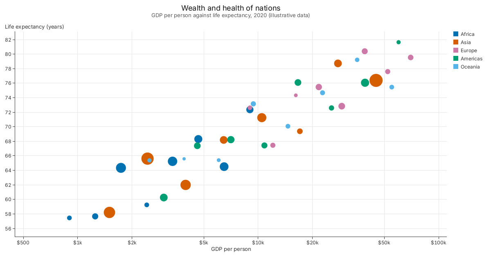

# Gup: GPU-Accelerated Data Visualization

> A few lines of Rust for a publication-quality chart, drawn on the GPU: in a
> window, a PNG, an SVG, egui, Bevy or the browser.



See [the gallery](examples/INDEX.md) for ten charts and the code that draws
each, or [the tour](docs/tour/README.md) for what else Gup can do, one short
page at a time, or run `cargo run -p gup-egui --example tour` to page through
the tour with every chart live.

Gup (GPU Update Pattern) is a data visualization library for Rust. Data
encodings (scales, palettes, transfer functions) are shader functions that run
on the GPU, each with an exact CPU twin for axes, legends, picking and SVG, so
zooming and panning change uniforms rather than data.

## Why Gup

Figures are from [`PERF_BUDGETS.md`](./crates/gup-core/PERF_BUDGETS.md), release
build, Intel HD Graphics 630 (an integrated GPU), Mesa 26.0.0, Vulkan:

- Zooming writes no column bytes: `zoom.columns.bytes` is 0 over 600 frames.
- Culling by chunk: 4M sorted rows draw in about 10 ms of GPU time with 14 draws
  (`zoom_culled.gpu_pass.median_ms`, `zoom_culled.draws.median`).
- The reference scatter's WASM build is about 360 KB gzipped, under a 400 KB cap
  for gup-core over wgpu (`wasm.scatter.gz_bytes`, `wasm.over_wgpu.gz_bytes`).

The timings apply to that machine; measure on yours before comparing.

## Key Features

- **Encodings are GPU functions.** Scales and palettes are WGSL with f64 CPU
  mirrors; write your own with `#[wgsl_function]`.
- **A chunked GPU column store.** Accessors run once; zooming writes no column
  bytes.
- **One chart, every target.** A window, a PNG, an SVG, a texture for egui or
  Bevy, and a WebGPU canvas.
- **Typed channels.** A wrong value type, an unknown channel or the wrong mark
  does not compile.
- **Builders that do not trap you.** Start from `gup::scatter`, then drop to the
  typed `Selection` API.
- **The same pixels on every platform.** CI renders every gallery and tutorial
  chart on Linux (Vulkan), Windows (DX12) and macOS (Metal) and compares them
  with the same golden images.
- **Accessible by default.** A text alternative for every chart, keyboard focus,
  zoom and pan, row announcements, a browser data table and a high-contrast
  theme: see the [accessibility guide](./docs/ACCESSIBILITY.md), which also says
  what Gup does not do.

## Not yet

Each item names its track in
[`IMPLEMENTATION_STRATEGY.md`](./docs/IMPLEMENTATION_STRATEGY.md):

- No CSV or serde input: rows enter through closures, `Columns` or Arrow record
  batches (feature `arrow`).
- Nothing above 10M rows is measured, and there is no level of detail (N5).
- No PDF export (N6).
- No pie, violin, density or choropleth charts, and no facets.

## Requirements

- **Rust 1.93 or newer.**
- **A GPU or software driver that wgpu supports**: Vulkan on Linux (CI uses
  Mesa's lavapipe software driver), DX12 on Windows, Metal on macOS, or WebGPU
  in a browser. You add no GPU crate and no async runtime.
- **wgpu 27, if your app has its own wgpu device.** `gup::wgpu` is the exact
  version, so use `gup::wgpu` rather than a second wgpu dependency. wgpu 27's
  `DeviceDescriptor` has an `experimental_features` field: if you build the
  descriptor yourself, set it, for example to
  `wgpu::ExperimentalFeatures::disabled()`.

Features:

| Feature  | On by default | Adds                                                          |
| -------- | ------------- | ------------------------------------------------------------- |
| `window` | yes           | A winit window target: `show` and `GupApp`                    |
| `svg`    | yes           | Data marks in `SvgTarget`                                     |
| `web`    | no            | A `<canvas>` target and host (`web::CanvasApp`); wasm32 only  |
| `arrow`  | no            | `Columns::from_arrow`: Arrow record batches as columnar input |

The egui and Bevy integrations are separate crates, `gup-egui` and `gup-bevy`.

Gup is not on crates.io yet, so depend on it from git, pinned to a commit you
have tested against. A branch alone follows `main` and can change under you:

```toml
[dependencies]
gup = { git = "https://github.com/au-phiware/gup", rev = "<full commit hash>" }
```

Or depend on a checkout:

```toml
[dependencies]
gup = { path = "../gup" }
```

Every gup crate in one app must come from the same commit or checkout.

## Quick Start

Gup is not on crates.io yet; release 0.1 will be. Add it to `Cargo.toml` as
shown in [Requirements](#requirements).

Then draw a scatter chart and save it as a PNG:

```rust,no_run
use gup::prelude::*;

struct Row { gdp: f64, life_exp: f64, continent: String, population: f64 }

fn main() -> gup::Result<()> {
    let data = vec![
        Row { gdp: 1e3, life_exp: 55.0, continent: "Africa".into(), population: 3e7 },
        Row { gdp: 2e4, life_exp: 74.0, continent: "Europe".into(), population: 6e7 },
        Row { gdp: 6e4, life_exp: 81.0, continent: "Asia".into(), population: 1e9 },
    ];

    let mut chart = gup::scatter(data)
        .x(|d| d.gdp)
        .y(|d| d.life_exp)
        .color(|d| d.continent.clone())
        .size(|d| d.population);
    let cx = Context::shared()?;
    chart.save_png(&cx, "chart.png", 800, 500)?;
    Ok(())
}
```

In the browser, use `default-features = false, features = ["web", "svg"]` and
`gup::web::CanvasApp`.

To keep the image in memory instead, for a test say:

```rust
use gup::prelude::*;

struct Row { gdp: f64, life_exp: f64, continent: String, population: f64 }

fn main() -> gup::Result<()> {
    let data = vec![
        Row { gdp: 1e3, life_exp: 55.0, continent: "Africa".into(), population: 3e7 },
        Row { gdp: 2e4, life_exp: 74.0, continent: "Europe".into(), population: 6e7 },
        Row { gdp: 6e4, life_exp: 81.0, continent: "Asia".into(), population: 1e9 },
    ];

    let mut chart = gup::scatter(data)
        .x(|d| d.gdp)
        .y(|d| d.life_exp)
        .color(|d| d.continent.clone())
        .size(|d| d.population);
    let image = chart.render(&Context::shared()?, 800, 500)?;
    assert_eq!(image.dimensions(), (800, 500));
    Ok(())
}
```

To open a window instead, pass the chart to `gup::show(chart)`. Continue with
[Tutorial 1, Getting Started](./docs/tutorials/01_getting_started.md), or see
all [tutorials](./docs/tutorials/README.md).

## Architecture Highlights

See [`TECHNICAL_APPROACH.md`](./docs/TECHNICAL_APPROACH.md).

- **Shader functions with CPU mirrors**: `ShaderFn`, `then` and
  `#[wgsl_function]`, composed at build time.
- **GPU column store**: chunked, relative origins, validity bits, dictionaries,
  `Retain`, `append` and `Window`.
- **Typed channels and marks**: `#[derive(Mark)]`, compile-time errors.
- **One scale family**: linear, pow, log, symlog, time, band, point and colour
  scales, with ticks and legends from the mirrors.
- **`Plot` and `Scene`**: layout, guides and legends resolve to a plain scene.
- **Render targets**: image, window, texture, canvas and SVG, one render pass.
- **Interaction**: CPU and GPU picking, tooltips, zoom, pan, brush and culling.
- **Builders**: `scatter`, `line`, `bar`, `barh`, `area`, `histogram`, `heatmap`
  and `boxplot`, over the same `Plot`.
- **Hosts**: `show`, a WebGPU canvas, `gup-egui` and `gup-bevy`.
- **Gates**: performance and WASM budgets, visual regression, a browser smoke
  test and a dogfood suite.

## Development Status

Release 0.1 is the first published version; see [CHANGELOG.md](CHANGELOG.md) for
what it contains and for the versioning policy. What comes next is in the
[strategic review](./docs/planning/STRATEGIC_REVIEW_2026-11.md) (tracks N4 to
N6).

## Documentation

- [`CHANGELOG.md`](CHANGELOG.md) - What each release contains, and the
  versioning policy
- [`docs/tour/README.md`](./docs/tour/README.md) - A tour of what Gup can do:
  short pages, each with the code and the image it draws
- [`docs/tutorials/README.md`](./docs/tutorials/README.md) - Seven tested
  tutorials, from a first chart to custom marks
- [`MISSION_AND_GOALS.md`](./docs/MISSION_AND_GOALS.md) - Project vision and
  objectives
- [`TECHNICAL_APPROACH.md`](./docs/TECHNICAL_APPROACH.md) - How Gup works today
- [`IMPLEMENTATION_STRATEGY.md`](./docs/IMPLEMENTATION_STRATEGY.md) - How it is
  built, and what is next
- [`MARKET_ANALYSIS.md`](./docs/MARKET_ANALYSIS.md) - Competitive positioning
- [docs/README.md](docs/README.md) and [docs/INDEX.md](docs/INDEX.md) - Reading
  guide and full listing
- [docs/planning/stories/INDEX.md](docs/planning/stories/INDEX.md) - All stories
  and their status

## Contributing

Gup is developed in the open with community input. See the documentation above
for technical details and architectural decisions.

Building the workspace from source on Windows: `.cargo/config.toml` sets a bash
rustc wrapper that Windows cannot run, so set
`CARGO_BUILD_RUSTC_WORKSPACE_WRAPPER=""` (empty unsets it) first.

## Examples

```bash
cargo run --example hello_world       # a sine wave with tooltips
cargo run --example 04_bar_chart      # grouped bars (--stacked to stack)
cargo run -p gup-core --example live_append   # rows appended from a thread
```

See [examples/README.md](examples/README.md) for the full list. Set
`GUP_SCREENSHOT_PATH=out.png` to render one frame headless. For a browser build,
see `mask wasm-browser`.

## Workspace Crates

A plain `cargo build` or `cargo test` at the repository root builds only the
`gup` crate (`default-members = ["."]`), a facade over `gup-core`. The other
workspace members are built with `-p`:

| Crate                          | Status                                                                 | Published |
| ------------------------------ | ---------------------------------------------------------------------- | --------- |
| `gup` (this directory)         | The facade: `gup::prelude`, the builders and the docs you are reading. | yes       |
| `crates/gup-core`              | The core: context, column store, scales, marks, plot, scene, targets.  | yes       |
| `crates/gup-core-macros`       | `#[wgsl_function]` and `#[derive(Mark)]`.                              | yes       |
| `crates/gup-wgsl`              | WGSL library, build-time composition and the run-time linker.          | yes       |
| `crates/gup-text`              | Font loading, shaping and the glyph atlas.                             | yes       |
| `crates/gup-visual-regression` | Golden-image and structural check harness (`mask visual-regression`).  | no        |
| `gup-egui`                     | egui integration (`GupWidget`).                                        | yes       |
| `gup-bevy`                     | Bevy integration (`GupPlugin`), built by the `integrations` CI job.    | yes       |

`crates/gup-culling-lod` holds GPU culling and LOD code from before the core was
rewritten. It is parked: out of the workspace and CI, until the LOD work in
track N5 (scale) ports what it needs. See its
[README](crates/gup-culling-lod/README.md).

`cargo test -p gup-egui` tests the egui integration. `gup-bevy` is built by the
`integrations` CI job, not by `mask all-check`:
`cargo test -p gup-bevy -- --test-threads=1`.

## License

This project is licensed under the GNU General Public License v3.0 or later
(GPL-3.0-or-later). See [COPYING](COPYING) for details.
