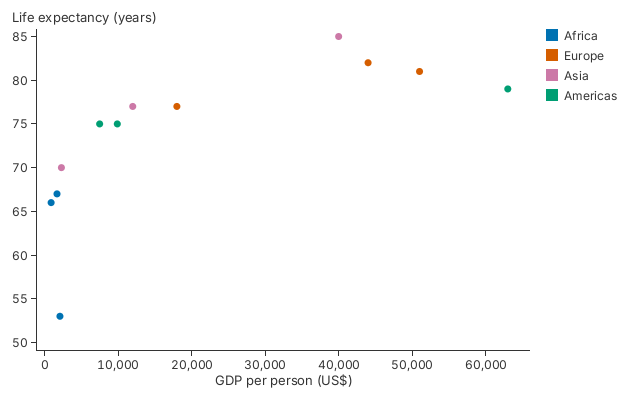

# 1. From Rows to a Chart

A chart starts from your rows and one closure for each thing you want to see.

<!-- tour: docs/tour/snippets/01_five_lines.rs#five_lines -->

```rust
gup::scatter(countries())
    .x(|c| c.1)
    .y(|c| c.2)
    .color(|c| c.0)
    .x_title("GDP per person (US$)")
    .y_title("Life expectancy (years)")
```



`countries()` returns twelve tuples of region, GDP, life expectancy and
population. Any iterator of any type works, so a `Vec` of your own structs does
too. `.x` and `.y` say where each row goes, `.color` gives each region a colour
and a legend entry, and the two titles label the axes. Everything else (axis
ranges, ticks, theme) has a default.

To keep the chart, ask it to save itself. `save_png` and `save_svg` take the
same arguments.

<!-- tour: docs/tour/snippets/01_five_lines.rs#save -->

```rust
pub fn save(dir: &Path) -> gup::Result<()> {
    let cx = Context::shared()?;
    let mut chart = five_lines();
    chart.save_png(&cx, dir.join("chart.png"), 640, 400)?;
    chart.save_svg(&cx, dir.join("chart.svg"), 640, 400)
}
```

`gup::show(chart)` opens the same chart in a window, where the wheel zooms and a
drag pans. `chart.to_svg(&cx, 640, 400)` returns the SVG as a `String`.

**Go deeper**: [Tutorial 1](../tutorials/01_getting_started.md), from
[Step 2](../tutorials/01_getting_started.md#step-2-draw-your-first-scatter-chart).
API: `gup::scatter`, `ChartExt::save_png`, `ChartExt::save_svg`, `gup::show`.

**Not in 0.1**: there is no HTML export, and no PDF export (see `CHANGELOG.md`,
"Known limitations").
