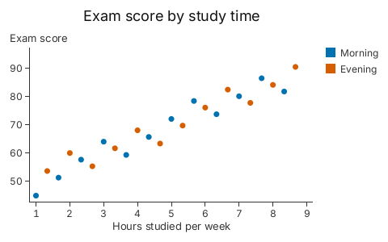
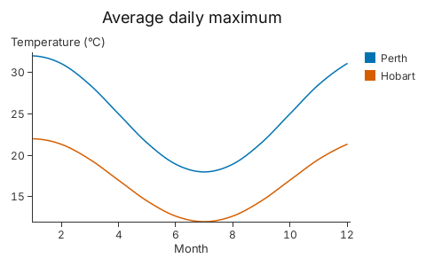
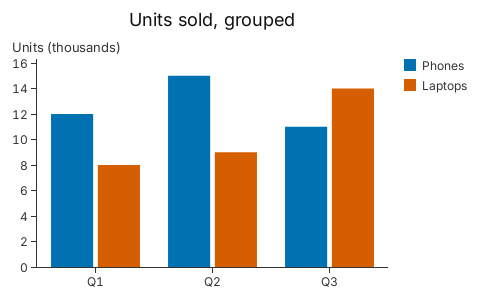
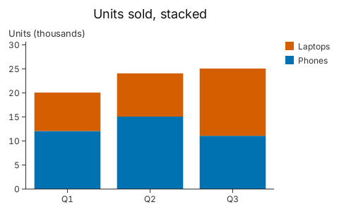
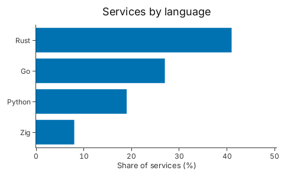
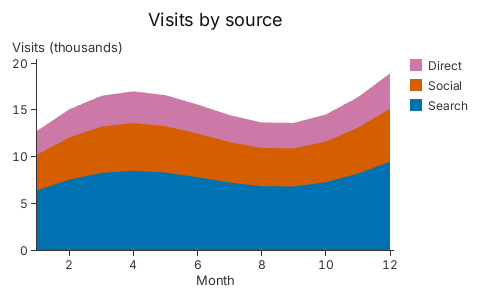
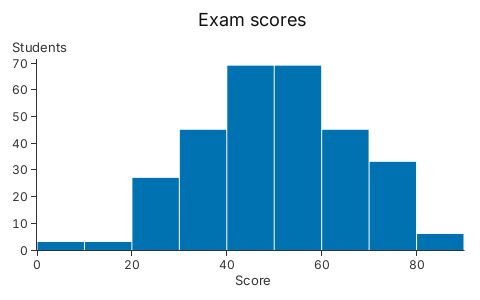
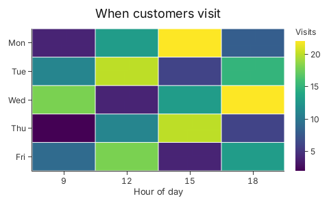
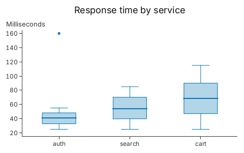

# 2. One Builder for Each Chart

Each kind of chart has its own builder, and the setters have the same names on
all of them.

Every chart on this page is the call shown above its image. The rows come from a
small function in `docs/tour/snippets/02_vocabulary.rs`, each returning a `Vec`
of a struct with named fields (`Student { hours, score, shift }`,
`Sale { quarter, product, units }` and so on), so each block is only the chart.

## Scatter

<!-- tour: docs/tour/snippets/02_vocabulary.rs#scatter -->

```rust
gup::scatter(students())
    .x(|s| s.hours)
    .y(|s| s.score)
    .color(|s| s.shift)
    .title("Exam score by study time")
    .x_title("Hours studied per week")
    .y_title("Exam score")
```



A disc for each row. `.color` splits the rows into groups.

## Line

<!-- tour: docs/tour/snippets/02_vocabulary.rs#line -->

```rust
gup::line(temperatures())
    .x(|t| t.month)
    .y(|t| t.celsius)
    .color(|t| t.city)
    .curve(Curve::MonotoneX)
    .title("Average daily maximum")
    .x_title("Month")
    .y_title("Temperature (°C)")
```



One line for each colour key. `Curve::MonotoneX` joins the rows with a smooth
curve that never overshoots a row's value.

## Bar

<!-- tour: docs/tour/snippets/02_vocabulary.rs#bar -->

```rust
gup::bar(sales())
    .x(|s| s.quarter)
    .y(|s| s.units)
    .group(|s| s.product)
    .title("Units sold, grouped")
    .y_title("Units (thousands)")
```



`.group` puts the bars of one category side by side.

<!-- tour: docs/tour/snippets/02_vocabulary.rs#bar_stacked -->

```rust
gup::bar(sales())
    .x(|s| s.quarter)
    .y(|s| s.units)
    .stack(|s| s.product)
    .title("Units sold, stacked")
    .y_title("Units (thousands)")
```



`.stack` piles them up, so the bar's height is the total.

## Barh

<!-- tour: docs/tour/snippets/02_vocabulary.rs#barh -->

```rust
gup::barh(languages())
    .y(|l| l.name)
    .x(|l| l.share)
    .title("Services by language")
    .x_title("Share of services (%)")
```



A bar chart on its side, for long category names. The category is `.y` and the
value is `.x`.

## Area

<!-- tour: docs/tour/snippets/02_vocabulary.rs#area -->

```rust
gup::area(visits())
    .x(|v| v.month)
    .y(|v| v.count)
    .stack(|v| v.source)
    .title("Visits by source")
    .x_title("Month")
    .y_title("Visits (thousands)")
```



The region under a line. `.stack` piles one layer on another, so the top edge is
the total.

## Histogram

<!-- tour: docs/tour/snippets/02_vocabulary.rs#histogram -->

```rust
gup::histogram(exams())
    .x(|e| e.score)
    .bins(Bins::Width(10.0))
    .title("Exam scores")
    .x_title("Score")
    .y_title("Students")
```



Gup counts the rows into bins whose edges fall on round numbers. `Bins::Width`
fixes the width; the default, `Bins::Auto`, picks one.

## Heatmap

<!-- tour: docs/tour/snippets/02_vocabulary.rs#heatmap -->

```rust
gup::heatmap(customers())
    .x(|c| c.hour)
    .y(|c| c.day)
    .color_value(|c| c.visits)
    .legend_title("Visits")
    .title("When customers visit")
    .x_title("Hour of day")
```



One cell for each row, coloured through a continuous scale with a legend. There
is no counting: one row is one cell.

## Box plot

<!-- tour: docs/tour/snippets/02_vocabulary.rs#boxplot -->

```rust
gup::boxplot(requests())
    .x(|r| r.service)
    .y(|r| r.ms)
    .title("Response time by service")
    .y_title("Milliseconds")
```



Give it one row for each value. Gup computes the quartiles, the median, the
whiskers and the dots beyond them.

`.title`, `.subtitle`, `.x_title`, `.y_title`, `.grid`, `.x_tick_format`,
`.y_tick_format` and `.theme` work on every builder, and `.color` works on all
but the heatmap.

**Go deeper**: [Tutorial 7](../tutorials/07_chart_types.md) has a section for
each chart, with when to choose it. API: `gup::scatter`, `gup::line`,
`gup::bar`, `gup::barh`, `gup::area`, `gup::histogram`, `gup::heatmap`,
`gup::boxplot`.

**Not in 0.1**: pie, violin, density and choropleth charts, and facets (see
`CHANGELOG.md`, "Known limitations").
