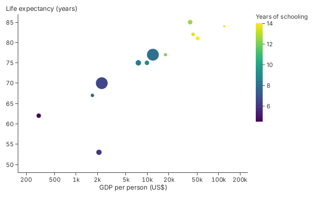

# 3. Position, Size and Colour

A mark's position, size and colour each come from a column of your data, through
a scale.

<!-- tour: docs/tour/snippets/03_encodings.rs#encodings -->

```rust
gup::scatter(countries())
    .x(|c| c.gdp)
    .y(|c| c.life)
    .size(|c| c.people)
    .color_value(|c| c.schooling)
    .color_value_scale(Sequential::viridis())
    .legend_title("Years of schooling")
    .x_scale(Log::new())
    .x_title("GDP per person (US$)")
    .y_title("Life expectancy (years)")
```



Each row is a `Country { gdp, life, people, schooling }`. `.x_scale(Log::new())`
spreads GDP, which covers more than two orders of magnitude, across the axis;
its ticks fall at 1, 2 and 5 times a power of ten. `.size` sizes each disc so
that its area follows the value. `.color_value` colours each disc by a number
through a continuous scale, here `Sequential::viridis()`, and the legend is a
colour ramp. (`.color`, in chapter 1, colours by a category instead.)

## The scales

| Scale         | What it does                                                                                         | See                                        |
| ------------- | ---------------------------------------------------------------------------------------------------- | ------------------------------------------ |
| `Linear`      | Numbers to positions in proportion: the default axis                                                 | Every chapter                              |
| `Log`         | Numbers on a logarithmic axis                                                                        | This chapter                               |
| `Time`        | Unix seconds, with labels that name the months and years                                             | [Chapter 4](04_axes_and_labels.md)         |
| `Band`        | Category keys to evenly spaced slots: the bar, box plot and heatmap builders make one from your keys | [Chapter 2](02_vocabulary.md)              |
| `PointScale`  | Keys to evenly spaced points, used on a `Plot`'s axis; there is no image of it in the tour           | `gup_core::PointScale` in the rustdoc      |
| `Categorical` | Keys to colours: `Categorical::okabe_ito()` is what `.color(..)` uses                                | [Chapter 5](05_colour_and_themes.md)       |
| `Sequential`  | A number to a colour along a ramp: `Sequential::viridis()`                                           | This chapter, and the heatmap in chapter 2 |
| `Pow`         | A number to a power: `Pow::sqrt()` is what `.size_scale(..)` takes                                   | `gup_core::Pow` in the rustdoc             |
| `Symlog`      | Like `Log`, with a linear stretch through zero                                                       | `gup_core::Symlog` in the rustdoc          |
| `Diverging`   | A number to a colour along a ramp with a neutral middle                                              | `gup_core::Diverging` in the rustdoc       |

## Where an axis ends

| Axis                                                               | Ends at                                                              | Checked by                                                                    |
| ------------------------------------------------------------------ | -------------------------------------------------------------------- | ----------------------------------------------------------------------------- |
| The default: a scatter chart's axes, a line or area chart's y axis | A round number past the data, from a step finer than the tick labels | `y_axes_still_round_out` in `crates/gup-core/tests/axis_extent.rs`            |
| A bar chart's value axis                                           | A labelled tick                                                      | `crates/gup-core/tests/bar_axis_ends.rs`                                      |
| A line or area chart's x axis                                      | The first and last rows                                              | `crates/gup-core/tests/axis_extent.rs`                                        |
| Any axis with `Linear::new().domain(a, b)`                         | `a` and `b`, whatever the data is                                    | `the_policy_survives_x_scale_and_an_explicit_domain_wins` in `axis_extent.rs` |

**Go deeper**:
[Tutorial 1, Step 4](../tutorials/01_getting_started.md#step-4-colour-by-key-size-by-value)
and
[Step 5](../tutorials/01_getting_started.md#step-5-titles-a-grid-and-a-log-scale);
[Tutorial 2, Step 4](../tutorials/02_data_binding.md#step-4-colour-through-a-scale)
for colour scales on a `Plot`. API: `Log`, `Sequential`, `Pow`, `Time`.
