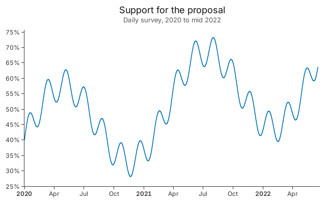
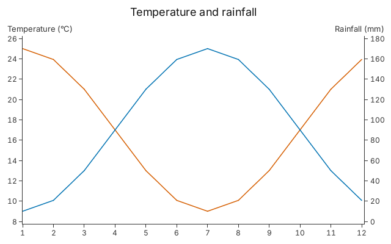
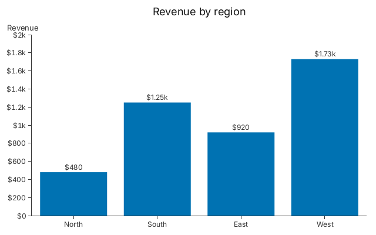

# 4. Axes and Labels

Time axes, a second y axis and tick labels you write yourself.

## A time axis

<!-- tour: docs/tour/snippets/04_axes_and_labels.rs#time_axis -->

```rust
gup::line(survey())
    .x(|s| s.day)
    .y(|s| s.support)
    .x_scale(Time::new())
    .y_tick_format(|v| format!("{v:.0}%"))
    .title("Support for the proposal")
    .subtitle("Daily survey, 2020 to mid 2022")
```



`survey()` returns 900 daily `Survey { day, support }` rows, with `day` in Unix
seconds. `Time::new()` picks a calendar step for its ticks (here three months)
and labels each January with its year in a heavier weight, so nobody has to
count. A tick format is a closure from the tick's value to its label, so a
percent sign is one `format!`. There is no built-in percent, date or currency
formatter; a custom date label is a closure over Unix seconds, and
`crates/gup-core/tests/tick_format.rs` has one (`date_axis`).

## A second y axis

<!-- tour: docs/tour/snippets/04_axes_and_labels.rs#dual_axis -->

```rust
let mut plot = Plot::new();
plot.legends(false)
    .title("Temperature and rainfall")
    .y_title("Temperature (°C)")
    .y_right_title("Rainfall (mm)");
let x = plot.x(Linear::new());
let left = plot.y(Linear::new());
let right = plot.y_right(Linear::new());
plot.line(climate())
    .x_with(x.encode(|c: &Climate| c.month))
    .y_with(left.encode(|c: &Climate| c.celsius))
    .color(OKABE_ITO_DISTINCT[1]);
plot.line(climate())
    .x_with(x.encode(|c: &Climate| c.month))
    .y_with(right.encode(|c: &Climate| c.rain_mm))
    .color(OKABE_ITO_DISTINCT[0]);
plot
```



A builder has no right-axis setter, so this chart is a `Plot`, the layer API
under every builder. `plot.y_right(..)` adds the second axis and returns a
handle. A layer reads the right axis through that handle: the orange line
(temperature) is on the left axis and the blue line (rainfall) on the right.

## Labels on the value axis and on the bars

<!-- tour: docs/tour/snippets/04_axes_and_labels.rs#dollars -->

```rust
/// A dollar label: thousands take a `k`, smaller values are written out.
fn dollars(v: f64) -> String {
    if v.abs() < 1000.0 {
        format!("${v}")
    } else {
        format!("${}k", v / 1000.0)
    }
}
```

<!-- tour: docs/tour/snippets/04_axes_and_labels.rs#bar_labels -->

```rust
gup::bar(revenue())
    .x(|r| r.region)
    .y(|r| r.dollars)
    .y_tick_format(dollars)
    .value_labels_with(dollars)
    .title("Revenue by region")
    .y_title("Revenue")
```



`.y_tick_format` labels the ticks and `.value_labels_with` labels the bars, here
with the same function, so the two read alike. `.value_labels()` alone writes
each value with the default format.

**Go deeper**:
[Tutorial 2, Step 5](../tutorials/02_data_binding.md#step-5-a-second-y-axis) for
the second axis; [Tutorial 7](../tutorials/07_chart_types.md#scatter) uses
`.y_tick_format`. API: `Time`, `Plot::y_right`, `Plot::y_right_tick_format`,
`BarChart::value_labels_with`.
