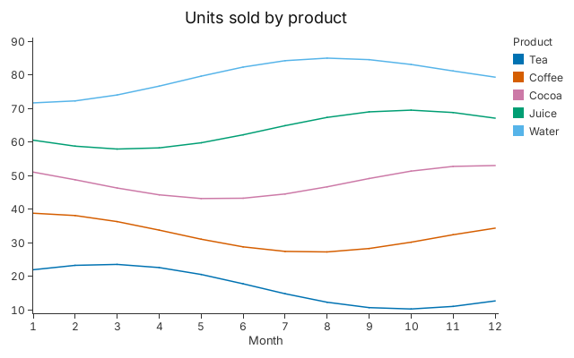
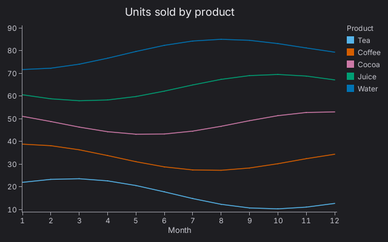
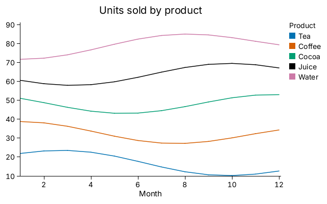

# 5. Colour and Themes

A colour palette that stays readable for colour-blind people, and two themes
that change the whole chart.

<!-- tour: docs/tour/snippets/05_colour_and_themes.rs#palette -->

```rust
gup::line(sales())
    .x(|s| s.month)
    .y(|s| s.units)
    .color(|s| s.product)
    .legend_title("Product")
    .title("Units sold by product")
    .x_title("Month")
```



`sales()` returns `Sale { month, product, units }` rows. `.color` takes colours
in order from `OKABE_ITO_DISTINCT`, the default palette, and the legend lists
each key beside its colour. The palette, in order:

| Colour (in order) | Hex       |
| ----------------- | --------- |
| Blue              | `#0072B2` |
| Vermillion        | `#D55E00` |
| Reddish purple    | `#CC79A7` |
| Bluish green      | `#009E73` |
| Sky blue          | `#56B4E9` |
| Orange            | `#E69F00` |
| Yellow            | `#F0E442` |
| Black             | `#000000` |

The chart above uses the first five. The first four are four different hues, so
a chart of up to four series gets four different hues. `.legends(false)` removes
the legend.

## A dark theme

<!-- tour: docs/tour/snippets/05_colour_and_themes.rs#dark -->

```rust
gup::line(sales())
    .x(|s| s.month)
    .y(|s| s.units)
    .color(|s| s.product)
    .legend_title("Product")
    .title("Units sold by product")
    .x_title("Month")
    .theme(Theme::dark())
```



`.theme(Theme::dark())` changes the background, the text, the axes and the
palette, which is retuned for a dark background.

## A high-contrast theme

<!-- tour: docs/tour/snippets/05_colour_and_themes.rs#high_contrast -->

```rust
gup::line(sales())
    .x(|s| s.month)
    .y(|s| s.units)
    .color(|s| s.product)
    .legend_title("Product")
    .title("Units sold by product")
    .x_title("Month")
    .theme(Theme::high_contrast())
```



`Theme::high_contrast()` is for readers with low vision: black text and axes,
larger text, and a palette (`HIGH_CONTRAST`) whose colours are each at least 3:1
against the white background.

**Go deeper**:
[Tutorial 7, "A Dark Theme"](../tutorials/07_chart_types.md#a-dark-theme);
[Tutorial 2, Step 4](../tutorials/02_data_binding.md#step-4-colour-through-a-scale)
for colour scales. API: `Theme`, `OKABE_ITO_DISTINCT`, `HIGH_CONTRAST`,
`Categorical`.
