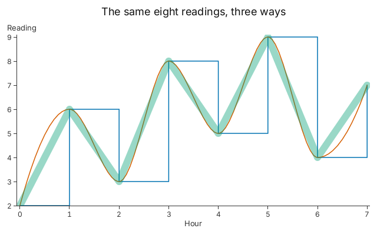

# 6. Lines and Curves

The same rows can be drawn as a step, a smooth curve or a wide translucent line.

<!-- tour: docs/tour/snippets/06_lines_and_curves.rs#curves -->

```rust
let mut plot = Plot::new();
plot.legends(false)
    .title("The same eight readings, three ways")
    .x_title("Hour")
    .y_title("Reading");
plot.line(readings())
    .x(|r| r.0)
    .y(|r| r.1)
    .curve(Curve::StepAfter)
    .color(Color::hex(0x0072b2));
plot.line(readings())
    .x(|r| r.0)
    .y(|r| r.1)
    .curve(Curve::MonotoneX)
    .color(Color::hex(0xd55e00));
let translucent = Color {
    a: 0.4,
    ..Color::hex(0x009e73)
};
plot.line(readings())
    .x(|r| r.0)
    .y(|r| r.1)
    .width(Px(12.0))
    .color(translucent);
plot
```



A builder sets one `curve` for the whole chart, so this chart is a `Plot` with a
line layer for each. `Curve::StepAfter` holds each value until the next row,
which suits a price or a setting. `Curve::MonotoneX` is smooth and stays within
the values of the two rows it joins. A translucent colour has one opacity along
the whole line: where the wide green line turns, the arms do not darken. `Curve`
has five variants: `Linear`, `Step`, `StepBefore`, `StepAfter` and `MonotoneX`.

**Go deeper**: [Tutorial 7, "Line"](../tutorials/07_chart_types.md#line) and
[Tutorial 2, Step 2](../tutorials/02_data_binding.md#step-2-build-a-plot-from-layers).
API: `Curve`, `Plot::line`.
