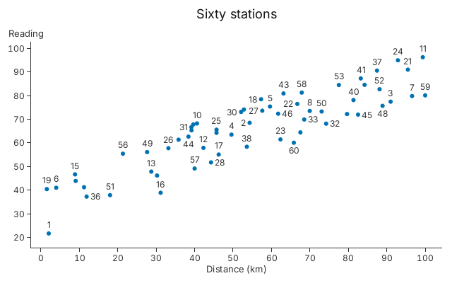

# 7. Text and Annotation

Labels on a crowded scatter chart that stay clear of each other and of the
points.

<!-- tour: docs/tour/snippets/07_text_and_annotation.rs#labels -->

```rust
let rows = stations();
gup::scatter(rows.clone())
    .x(|s| s.distance)
    .y(|s| s.reading)
    .radius(3.0)
    .title("Sixty stations")
    .x_title("Distance (km)")
    .y_title("Reading")
    .text(rows, |t| {
        t.x(|s| s.distance)
            .y(|s| s.reading)
            .text(|s| s.id.to_string())
            .anchor(Anchor::BOTTOM)
            .dy(-5.0)
            .halo(Px(2.0))
            .hide_overlaps(true)
            .fallbacks([
                (Anchor::LEFT, 5.0, 0.0),
                (Anchor::RIGHT, -5.0, 0.0),
                (Anchor::TOP, 0.0, 6.0),
            ])
            .avoid_points(Px(3.0));
    })
```



Each row is a `Station { id, distance, reading }`. `.text(rows, ..)` adds a
layer of labels at data positions. Four settings keep a crowded chart legible:

- `.halo(Px(2.0))` draws each label over an outline in the background colour.
- `.hide_overlaps(true)` drops a label that would overlap one already placed.
  Rows are taken in order, so sort them to rank the labels.
- `.fallbacks(..)` lists other places to try before a label is dropped: here to
  the right of the point, to the left, then below. Each is an anchor and an
  offset in pixels.
- `.avoid_points(Px(3.0))` keeps labels off the points themselves; pass the
  marks' radius.

Every resolve lays the labels out again, so zooming in shows more of them.
Tutorial 7 has the simple case, five labelled cities.

**Go deeper**:
[Tutorial 7, "Annotations"](../tutorials/07_chart_types.md#annotations). API:
`TextLayer::halo`, `TextLayer::hide_overlaps`, `TextLayer::fallbacks`,
`TextLayer::avoid_points`.
