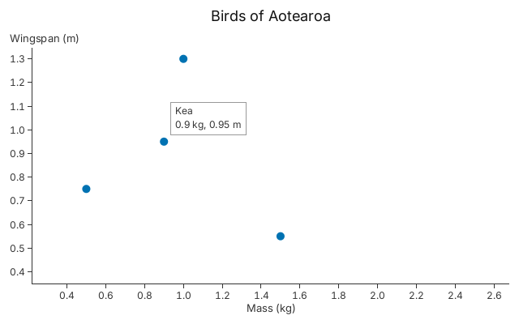
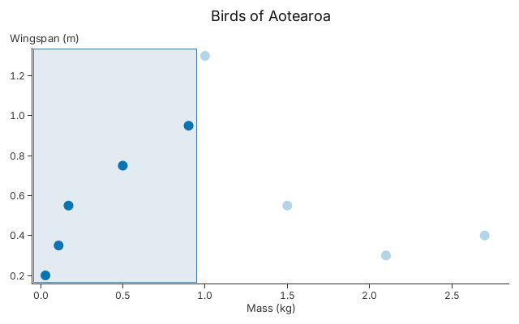

# 8. Interaction

Tooltips, zoom, pan and brushing, all driven by `Input` values, so the same code
runs in a window or in a test.

A chart does not need a window to be interactive: you send it `Input` values and
it answers with what changed. The two snippets below send them by hand, so the
images can be drawn without one. In a window, `gup::show` sends them for you. To
point at a mark, the snippets need its pixel position; this helper finds it from
the layout's ticks.

<!-- tour: docs/tour/snippets/08_interaction.rs#pixel -->

```rust
/// Where the data point `(x, y)` is drawn, in the chart's pixels.
fn pixel(layout: &Layout, x: f64, y: f64) -> (f32, f32) {
    let along = |ticks: &[(f64, f32)], v: f64| {
        let (first, last) = (ticks[0], ticks[ticks.len() - 1]);
        first.1 + ((v - first.0) * f64::from(last.1 - first.1) / (last.0 - first.0)) as f32
    };
    (along(&layout.x_ticks, x), along(&layout.y_ticks, y))
}
```

## A tooltip, after a zoom and a pan

<!-- tour: docs/tour/snippets/08_interaction.rs#tooltip -->

```rust
let mut chart = gup::scatter(birds())
    .x(|b| b.1)
    .y(|b| b.2)
    .radius(5.0)
    .title("Birds of Aotearoa")
    .x_title("Mass (kg)")
    .y_title("Wingspan (m)")
    .tooltip(|b| format!("{}\n{} kg, {} m", b.0, b.1, b.2));
let cx = Context::shared()?;
chart.resolve(&cx, 640.0, 400.0)?;

// Zoom about the Kea, then drag the view a little.
let kea = pixel(chart.layout().unwrap(), 0.90, 0.95);
let _ = chart.handle(Input::wheel(kea, 1.0));
let _ = chart.handle(Input::pointer_down(kea, Button::Primary));
let _ = chart.handle(Input::pointer_moved((kea.0 - 30.0, kea.1 + 20.0)));
let _ = chart.handle(Input::pointer_up(
    (kea.0 - 30.0, kea.1 + 20.0),
    Button::Primary,
));
chart.resolve(&cx, 640.0, 400.0)?;

// Point at the Kea where it is now: the next resolve draws the tooltip.
let kea = pixel(chart.layout().unwrap(), 0.90, 0.95);
let _ = chart.handle(Input::pointer_moved(kea));
chart.resolve(&cx, 640.0, 400.0)?;
Ok(chart)
```



`.tooltip(..)` builds the text from the row. `handle` records what the pointer
is over and says whether to redraw; the tooltip itself is drawn by the next
`resolve`. The wheel zooms about the pointer and a drag pans. The other five
birds are out of view.

## A brush

<!-- tour: docs/tour/snippets/08_interaction.rs#brush -->

```rust
let mut chart = gup::scatter(birds())
    .x(|b| b.1)
    .y(|b| b.2)
    .radius(6.0)
    .title("Birds of Aotearoa")
    .x_title("Mass (kg)")
    .y_title("Wingspan (m)");
chart.plot_mut().drag(Drag::Brush);
let cx = Context::shared()?;
let plot = chart.resolve(&cx, 640.0, 400.0)?.layout.plot;

// Drag from the bottom-left corner to just right of the Kea.
let right = pixel(chart.layout().unwrap(), 0.95, 0.0).0;
let from = (plot.left() + 1.0, plot.bottom() - 1.0);
let to = (right, plot.top() + 1.0);
let _ = chart.handle(Input::pointer_down(from, Button::Primary));
let _ = chart.handle(Input::pointer_moved(to));
let _ = chart.handle(Input::pointer_up(to, Button::Primary));
Ok(chart)
```



With `Drag::Brush`, a drag selects the rows whose marks lie inside the
rectangle, and the other rows fade. `on_brush` tells you which rows are
selected, so a table or a second chart can follow.

**Go deeper**: [Tutorial 4](../tutorials/04_interactions.md), the
[tooltip](../tutorials/04_interactions.md#step-1-tooltips),
[zoom and pan](../tutorials/04_interactions.md#step-3-zoom-pan-and-reset) and
[brush](../tutorials/04_interactions.md#step-5-brushing) sections. API: `Input`,
`Response`, `Drag`, `Plot::on_brush`.

**Not in 0.1**: there is no builder call that hovers a row from data, so the
snippets work out the pixel themselves.
