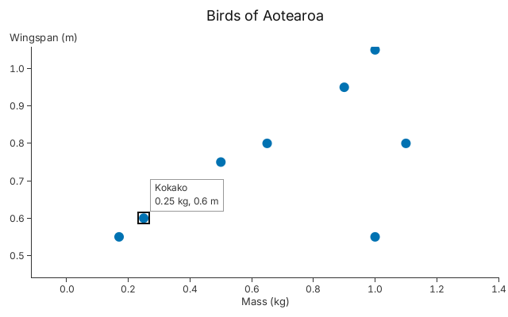

# 9. Accessibility

Keyboard navigation, and the words a screen reader needs, from the same chart.

A chart answers keys as it answers the pointer: you send `Input::key(..)`. The
arrows walk the rows, `+` and `-` zoom, Shift with an arrow pans, and the
focused row is hovered as if the pointer were on it, so its tooltip shows. This
snippet sends the keys by hand, as chapter 8 sent the pointer.

<!-- tour: docs/tour/snippets/09_accessibility.rs#keys -->

```rust
let mut chart = gup::scatter(birds())
    .x(|b| b.mass)
    .y(|b| b.wingspan)
    .radius(6.0)
    .title("Birds of Aotearoa")
    .x_title("Mass (kg)")
    .y_title("Wingspan (m)")
    .tooltip(|b| format!("{}\n{} kg, {} m", b.name, b.mass, b.wingspan));
let cx = Context::shared()?;
chart.resolve(&cx, 640.0, 400.0)?;

// Zoom in twice about the centre of the plot, then pan left with Shift.
for _ in 0..2 {
    let _ = chart.handle(Input::key(Key::ZoomIn));
}
for _ in 0..5 {
    let _ = chart.handle(Input::key_with(Key::Left, Modifiers::SHIFT));
}
// Right focuses the first row in view, in x order, then the next.
let _ = chart.handle(Input::key(Key::Right));
let _ = chart.handle(Input::key(Key::Right));
chart.resolve(&cx, 640.0, 400.0)?;
Ok(chart)
```



The ring is drawn into the chart, so it shows in a PNG too. The view is zoomed:
the ticks are finer than in the fitted chart, and four of the twelve birds (the
Bellbird, Tui, Harrier and Takahe) are out of view. The keys are the arrows
(Left and Right walk the rows of a layer, Up and Down move between layers), Home
and End, Enter and Space (run the row's click handlers), Escape (clear focus),
`+` or `=`, `-`, and `0` (reset the view).

## What a screen reader is given

Gup computes the words. The snippet below prints each of them for the chart
above: the text to speak for the focused row, the chart's description, the same
description as the SVG's `<title>` and `<desc>`, and the data table that a page
can hide beside the canvas.

<!-- tour: docs/tour/snippets/09_accessibility.rs#read_aloud -->

```rust
let mut chart = keys()?;
let cx = Context::shared()?;
let scene = chart.resolve(&cx, 640.0, 400.0)?.scene.clone();
let mut svg = SvgTarget::new();
svg.render(&scene)?;

let mut out = String::new();
writeln!(out, "focus: {}", chart.focus_text().unwrap_or("none")).unwrap();
let d = chart.describe().expect("the chart is resolved");
writeln!(out, "title: {}\ntext: {}", d.title, d.text).unwrap();
// The SVG's first children are the same words.
let svg = svg.svg();
let between = |open: &str, close: &str| {
    let from = svg.find(open).unwrap() + open.len();
    &svg[from..from + svg[from..].find(close).unwrap()]
};
writeln!(out, "svg title: {}", between("<title>", "</title>")).unwrap();
writeln!(out, "svg desc: {}", between("<desc>", "</desc>")).unwrap();
// The hidden table of the browser, as data.
let table = chart.data_table(1_000).expect("the chart is resolved");
writeln!(out, "table caption: {}", table.caption).unwrap();
writeln!(out, "table headers: {}", table.headers.join(", ")).unwrap();
write!(out, "table row 1: {}", table.rows[0].join(", ")).unwrap();
Ok(out)
```

It prints:

<!-- tour-output: docs/tour/snippets/09_accessibility.rs#read_aloud -->

```text
focus: Kokako; 0.25 kg, 0.6 m (2 of 8)
title: Birds of Aotearoa
text: Scatter chart, 12 data rows. X axis "Mass (kg)": 0.0 to 1.4. Y axis "Wingspan (m)": 0.5 to 1.0.
svg title: Birds of Aotearoa
svg desc: Scatter chart, 12 data rows. X axis &quot;Mass (kg)&quot;: 0.0 to 1.4. Y axis &quot;Wingspan (m)&quot;: 0.5 to 1.0.
table caption: Birds of Aotearoa
table headers: Mass (kg), Wingspan (m)
table row 1: 0.03, 0.2
```

The focus text is the tooltip with line breaks made into `"; "`, then the row's
place among the rows in view. The description names the axes as the titles you
gave them, and the table holds every row (at most 1,000 of them), however much
of the data is in view.

## Where each one exists

| Output                                   | PNG | SVG | Window | egui | Browser |
| ---------------------------------------- | --- | --- | ------ | ---- | ------- |
| `describe()` text                        | API | yes | API    | API  | yes     |
| Keys: focus, zoom, pan                   | -   | -   | yes    | yes  | yes     |
| Focus ring                               | yes | -   | yes    | yes  | yes     |
| `focus_text()`                           | API | -   | API    | API  | yes     |
| Live region that speaks it               | -   | -   | -      | -    | yes     |
| Hidden data table (`data_table(max)`)    | API | -   | API    | API  | yes     |
| `Theme::high_contrast()` (see chapter 5) | yes | yes | yes    | yes  | yes     |

"API" means Gup returns the text and nothing there speaks it. Only the browser
host (`web::CanvasApp`) sets the canvas's `aria-label`, adds a visually hidden
`aria-live` element that receives `focus_text()` after each frame, and adds the
hidden `<table>`. Gup produces the text; a native window or egui host must speak
it itself. The Bevy integration does not forward keys.

No screen reader has been tested by hand: what the guide says a reader receives
is what the page's DOM contains, not a recording of what it said. Gup makes no
claim of conformance to any accessibility standard.

**Go deeper**: the [accessibility guide](../ACCESSIBILITY.md), which says what
you must still do (titles, descriptions, tooltips), and
[Tutorial 4](../tutorials/04_interactions.md). API: `Input::key`, `Key`,
`Modifiers`, `Chart::describe`, `Chart::focus_text`, `Chart::data_table`,
`Theme::high_contrast`.

**Not in 0.1**: no native screen-reader bridge (AT-SPI, UI Automation,
NSAccessibility), and no patterns or textures as a second channel for colour
(see the guide's "Not supported").
