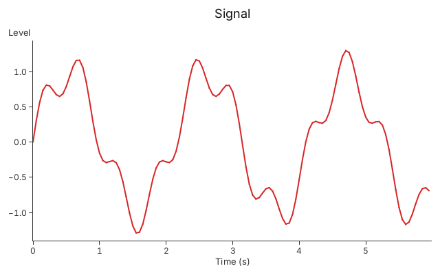
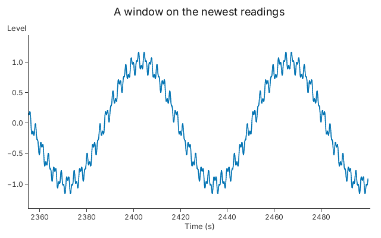

# 10. Live Data

Rows that arrive while the chart is on screen, and a window that keeps memory
bounded.

Every chart builder gives you an `Appender`, a handle you can send to another
thread. Rows pushed through it are uploaded to the GPU at the next resolve, in
the order they arrived, and the axes refit to them. This snippet pushes three
batches from the same thread so that the picture is the same every time; the
calls are the same from a producer thread.

<!-- tour: docs/tour/snippets/10_live_data.rs#append -->

```rust
let mut chart = gup::line(Vec::<Sample>::new())
    .x(|s| s.t)
    .y(|s| s.level)
    .width(2.0)
    .title("Signal")
    .x_title("Time (s)")
    .y_title("Level");
let feed = chart.appender();

// Three batches of 40 rows. Another thread could send them.
for batch in 0..3 {
    feed.extend((0..40).map(|i| sample(batch * 40 + i)))
        .expect("the chart is alive");
}
chart.resolve(&Context::shared()?, 640.0, 400.0)?;
Ok(chart)
```



`push` adds one row and `extend` adds a batch. Both return an error once the
chart has been dropped, which is how a producer thread learns to stop. In a
window, `gup::show` redraws when rows arrive. This is the producer from
[Tutorial 5](../tutorials/05_streaming_data.md): `feed` is the chart's
`Appender`, and the chart was built with a window (below).

<!-- tour-quote: docs/tutorials/05_streaming_data.md -->

```rust
    std::thread::spawn(move || {
        for i in 1.. {
            std::thread::sleep(Duration::from_millis(20));
            let t = f64::from(i) * 0.02;
            // `Err` means the window closed: stop.
            if feed.push((t, (t * 4.0).sin())).is_err() {
                break;
            }
        }
    });

    gup::show(chart)
```

## A window on the newest rows

A chart that runs for days cannot keep every row. `RowWindow::LastRows(n)` keeps
the newest `n` and lets older rows go. `Retain::GpuOnly` also drops the CPU copy
of each row after it is uploaded, so the rows live on the GPU alone.

<!-- tour: docs/tour/snippets/10_live_data.rs#window -->

```rust
let cx = Context::shared()?;
let mut chart = gup::line(Vec::<Sample>::new())
    .x(|s| s.t)
    .y(|s| s.level)
    .width(1.5)
    .title("A window on the newest readings")
    .x_title("Time (s)")
    .y_title("Level")
    .window(RowWindow::LastRows(2_000));
chart.layers_mut()[0].retain(Retain::GpuOnly);
let feed = chart.appender();

for batch in 0..25 {
    feed.extend((0..2_000).map(|i| reading(batch * 2_000 + i)))
        .expect("the chart is alive");
    chart.resolve(&cx, 640.0, 400.0)?;
}
// 50,000 rows came in. Rows leave a chunk (1,024 rows or more) at a
// time, so the layer holds the 2,000 newest and up to two chunks more.
let held = chart.layers_mut()[0].len();
assert!((2_000..=2_000 + 2 * 1_024).contains(&held), "{held}");
Ok(chart)
```



The 50,000 rows run to 2,500 seconds, and the axis starts near 2,355, so only
the newest rows are held (the test checks the count, and the snippet asserts
it). Rows leave a whole chunk at a time, which is what makes eviction cheap: it
moves no data. A chunk is at least 1,024 rows, so a window of 2,000 holds up to
two chunks more than it was asked for. A larger window uses chunks of a quarter
of its size, so it holds about 1.25 times as many rows as asked. A windowed
layer still draws, zooms and picks, and appending works under every `Retain`
policy (`Auto`, `Rows`, `Columns`, `GpuOnly`). What `GpuOnly` gives up is what
needs the rows: tooltips, `on_row` handlers, `pick`, vector output and rendering
on a second device.

**Go deeper**: [Tutorial 5](../tutorials/05_streaming_data.md), "Step 1" for the
appender, "Step 3" for windows and "Step 4" for `Retain`. API: `Appender`,
`RowWindow`, `Retain`, `Selection::append`.

**Not in 0.1**: `Appender` does not feed a columnar layer (chapter 11): a layer
made from `Columns` cannot be appended to.
