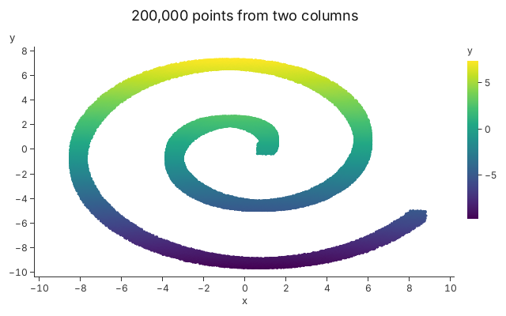

<!-- stale-if: GUP-629 GUP-630 GUP-631 GUP-632 GUP-664 -->

# 11. Big Data

Charts of millions of rows from columns of numbers, and the figures that have
been measured.

A row type and a closure per row are the right start for a few thousand rows.
For millions, you hand Gup the columns as they are. `Columns` holds named
columns of `f64` or `f32`, `Plot::add_columns` makes a layer over them, and each
channel names a column. No row struct is built, and each column is stored once,
shared, not copied.

<!-- tour: docs/tour/snippets/11_big_data.rs#columns -->

```rust
let (x, y) = spiral(200_000);
let cols = Columns::new().with("x", x)?.with("y", y)?;

let mut plot = Plot::new();
plot.title("200,000 points from two columns")
    .x_title("x")
    .y_title("y");
plot.add_columns::<Circle>(&cols)
    .x_column(&cols["x"])
    .y_column(&cols["y"])
    .attr(
        Circle::FILL,
        Sequential::viridis().encode_column(&cols["y"]),
    )
    .attr(Circle::RADIUS, Px(1.5))
    .legend_title(Circle::FILL, "y");
Ok(plot)
```



This image is 200,000 points, so that the test that draws it stays quick. The
same code runs on 10 million rows, and the numbers below are from runs that
size; the image above is not one of them. `Vec<f32>` columns work the same way
and take half the bytes for each value. Because a column is shared, binding it
to several channels or layers costs nothing more. A columnar layer has
everything a layer of rows has: `Retain`, culling, picking and vector output,
with the row's id being its index in the column. It cannot be appended to
(chapter 10).

Culling is automatic. Each chunk of rows knows the box its points span, and
chunks that lie outside the plot are not drawn, so a zoomed view of sorted data
draws a fraction of the chunks. There is no switch for it.

## Numbers

Each figure is quoted from the file named, on the machine and the date given.
They are an integrated GPU's numbers, not a representative target. Another
machine will differ: measure there before you compare.

| Figure                                                                              | Value                                                               | Source                                                                                                                      | Machine, date                                    |
| ----------------------------------------------------------------------------------- | ------------------------------------------------------------------- | --------------------------------------------------------------------------------------------------------------------------- | ------------------------------------------------ |
| 10M rows from `f64` columns, first resolve and peak memory, against the rows path   | 82.0 ms and 185 MiB, against 212.2 ms and 415 MiB (39% of the time) | GUP-664, Implementation Summary, "Measurements" (`scale_bench`, release, sorted rows, 1920 x 1080, median of 5 paired runs) | Intel HD 630, Vulkan; 2026-11-08                 |
| 10M rows from `f32` columns, first resolve and peak memory, against the rows path   | 87.0 ms and 109 MiB, against 212.2 ms and 415 MiB (41% of the time) | The same table                                                                                                              | The same                                         |
| Column bytes written over 600 frames of zooming (`zoom.columns.bytes`)              | 0                                                                   | `crates/gup-core/PERF_BUDGETS.md`, `zoom_bench` on 100,000 points                                                           | The development machine in that file; 2026-10-10 |
| Draws per frame of 4M sorted rows in 64 chunks, zoomed (`zoom_culled.draws.median`) | 14                                                                  | `crates/gup-core/PERF_BUDGETS.md`, `zoom_bench` (GUP-457)                                                                   | The same machine; 2026-10-18                     |
| GPU pass of the same frames at 1920 x 1080 (`zoom_culled.gpu_pass.median_ms`)       | 9.90 ms (median)                                                    | The same row's table; recorded with the GPU at its lowest clock, so a faster clock reads lower                              | The same machine; 2026-10-18                     |

"First resolve" is everything before the first frame: reading the data, encoding
and uploading it, and fitting the axes. Peak memory is the whole process's peak
resident set, including the columns themselves. A test in `tests/tour.rs` reads
`PERF_BUDGETS.md` and fails if a budget row is re-recorded and this page is not
updated.

## How far it goes

- Nothing above 10 million rows is measured by a release gate.
- The scale benchmark (GUP-627) ran 80 million rows once without an error, with
  a peak of 3.1 GB. It was one run on one machine, not a gate.
- 100 million rows was not run.
- There is no level of detail: a frame at the full extent draws every row.
- Above 10 million visible rows at full extent, a layer that has dropped its CPU
  data cannot be walked by keyboard focus, and `pick_row` and the brush find
  nothing there until you zoom in below the limit. Pointer hover and click still
  work through the GPU pick (GUP-667).

## Not yet

A 100-million-row demonstration (GUP-632) and a chart that draws a level of
detail are not there yet. `CHANGELOG.md`, "Known limitations", says the same: no
CSV or serde input, and nothing above 10M rows measured. Columns can also be
dictionary-coded keys (`KeyColumn`, for categories) and `Columns::from_arrow`
(feature `arrow`) reads Arrow record batches.

**Go deeper**: [Tutorial 2](../tutorials/02_data_binding.md), "Step 6: What a
Layer Keeps", and [Tutorial 5](../tutorials/05_streaming_data.md), "Step 4:
Retain". API: `Columns`, `Plot::add_columns`, `EncodeFn::encode_column`,
`Retain`.
