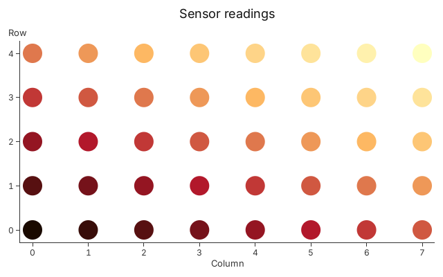
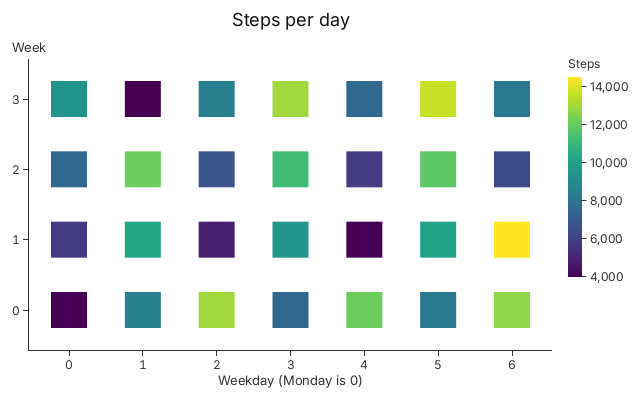

# 12. Under the Builders

Your own colour ramp and your own mark, written in WGSL, drawn through a `Plot`
with layers.

Every chart in chapters 1 to 11 came from a builder, which is a `Plot` with one
layer and setters for its channels. `chart.plot_mut()` borrows that plot, so you
can add a layer to it, and `chart.into_plot()` gives it to you by value. Below
the builder are three types you can write against. A `Plot` owns scales and
layers. A `Selection` is a layer: your rows drawn as one `Mark`. A `Mark` is a
Rust struct that lists the channels a row can drive, plus the WGSL that draws
it. Circle, Rect, Segment and Line are marks that ship with Gup, and a mark you
write is no different.

## A colour ramp of your own

A shader function maps a number to a number or a colour, and runs on the GPU. A
few lines of WGSL and a struct for its parameters give you `ember`, a ramp
through four stops.

<!-- tour: docs/tour/snippets/12_under_the_builders.rs#ember -->

```rust
/// A colour ramp through four stops, dark to pale.
#[derive(Clone, Debug)]
struct Ember {
    stops: [Color; 4],
}

#[gup::wgsl_function(
    path = "tour_ember",
    wgsl = r#"
    struct Params { dark: vec4<f32>, red: vec4<f32>, amber: vec4<f32>, pale: vec4<f32> }

    fn ember(t: f32, p: Params) -> vec4<f32> {
        let k = clamp(t, 0.0, 1.0) * 3.0;
        let a = mix(p.dark, p.red, clamp(k, 0.0, 1.0));
        let b = mix(a, p.amber, clamp(k - 1.0, 0.0, 1.0));
        return mix(b, p.pale, clamp(k - 2.0, 0.0, 1.0));
    }
"#
)]
impl ShaderFn for Ember {
    fn params(&self) -> EmberParams {
        let [dark, red, amber, pale] = self.stops;
        EmberParams {
            dark,
            red,
            amber,
            pale,
        }
    }
}
```

Now draw with it. A scale's `encode` binds a row to a channel, and `ember`
encodes like one: `Circle::FILL` takes its colour from `level`, a number between
0 and 1.

<!-- tour: docs/tour/snippets/12_under_the_builders.rs#function -->

```rust
let readings: Vec<Reading> = (0..40)
    .map(|i| {
        let (x, y) = (f64::from(i % 8), f64::from(i / 8));
        Reading {
            x,
            y,
            level: (x + 2.0 * y) / 15.0,
        }
    })
    .collect();
let ember = Ember {
    stops: [0x1a0a00, 0xb2182b, 0xfdb863, 0xffffbf].map(Color::hex),
};

let mut plot = Plot::new();
plot.title("Sensor readings")
    .x_title("Column")
    .y_title("Row");
let (x, y) = (plot.x(Linear::new()), plot.y(Linear::new()));
plot.add(Selection::<Reading, Circle>::new(readings))
    .attr(Circle::X, x.encode(|r: &Reading| r.x))
    .attr(Circle::Y, y.encode(|r: &Reading| r.y))
    .attr(Circle::RADIUS, Px(14.0))
    .attr(Circle::FILL, ember.encode(|r: &Reading| r.level));
plot
```



The `path` is a name for the WGSL module. It must be unique in the process, so
this page's is `tour_ember`. Chain it with the built-in scales through `.then`,
as Tutorial 3 does, and the same function can feed a size or a position.

## A mark of your own

A mark is one struct and one WGSL module. The fields of the struct are the
channels: each has a type, a role that says how the plot treats it, and
optionally a default. The WGSL has a `vertex` function that places the corners
of each row's quad and a `shade` function that colours each pixel. Here is a
square, with a size in pixels and a fill.

<!-- tour: docs/tour/snippets/12_under_the_builders.rs#mark max=70 -->

```rust
#[derive(Debug, Mark)]
#[mark(
    path = "tour_square",
    wgsl = r#"
    #import gup::view::{View, px_to_clip}
    #import gup::coverage::{rect_quad, box_coverage}

    struct SquareIn {
        x: f32,
        y: f32,
        size: f32,
        fill: vec4<f32>,
    }

    struct Varyings {
        @builtin(position) clip: vec4<f32>,
        @location(0) local: vec2<f32>,
        @location(1) half_size: vec2<f32>,
        @location(2) fill: vec4<f32>,
    }

    fn vertex(m: SquareIn, vertex_index: u32, row: u32, view: View) -> Varyings {
        let centre = vec2<f32>(m.x, m.y);
        let half_size = vec2<f32>(m.size * 0.5);
        let q = rect_quad(centre - half_size, centre + half_size, vertex_index, view.dpr);
        var out: Varyings;
        out.clip = px_to_clip(q.position, view);
        out.local = q.local;
        out.half_size = q.half_size;
        out.fill = m.fill;
        return out;
    }

    fn shade(v: Varyings) -> vec4<f32> {
        let alpha = v.fill.a * box_coverage(v.local, v.half_size);
        if (alpha <= 0.0) {
            discard;
        }
        return vec4<f32>(v.fill.rgb * alpha, alpha);
    }
"#,
    geometry = Quad
)]
struct Square {
    #[channel(role = X)]
    x: Px,
    #[channel(role = Y)]
    y: Px,
    #[channel(role = Size, default = Px(10.0))]
    size: Px,
    #[channel(role = Color, default = Color::BLACK)]
    fill: Color,
}

let mut plot = Plot::new();
plot.title("Steps per day")
    .x_title("Weekday (Monday is 0)")
    .y_title("Week");
plot.add(Selection::<Day, Square>::new(days()))
    .x(|d| d.weekday)
    .y(|d| d.week)
    .size(Px(36.0))
    .fill(Sequential::viridis().encode(|d: &Day| d.steps))
    .legend_title(Square::FILL, "Steps");
plot
```



`Plot::add` takes the layer, and its `fill` channel is encoded through viridis
like any other. `legend_title` names the colour legend. The mark's `path` is
`tour_square` here, and like a function's, it is a name for the whole process.

**Go deeper**: [Tutorial 2](../tutorials/02_data_binding.md), "Step 1: Drop From
a Builder to Its Plot" and "Step 2: Build a Plot From Layers";
[Tutorial 3](../tutorials/03_custom_shader_functions.md), for shader functions;
[Tutorial 6](../tutorials/06_custom_marks.md), for marks. API: `Plot`,
`Selection`, `Mark`, `ShaderFn`, `wgsl_function`.
