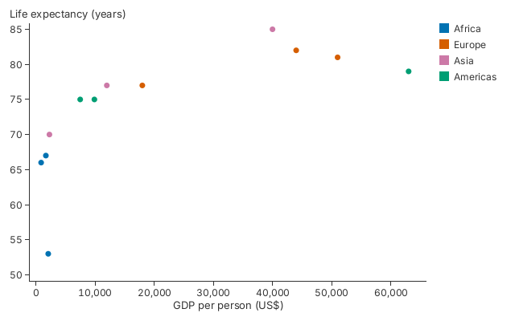

# 13. Everywhere It Runs

One chart, drawn into a window, a file, a texture, egui, Bevy or a browser
canvas.

A chart does not know where it is drawn. It resolves to a scene, and a target
draws the scene. The calls from chapter 1 are all it takes to reach the first
three targets below, and the same chart value works in the others.

<!-- tour: docs/tour/snippets/01_five_lines.rs#save -->

```rust
pub fn save(dir: &Path) -> gup::Result<()> {
    let cx = Context::shared()?;
    let mut chart = five_lines();
    chart.save_png(&cx, dir.join("chart.png"), 640, 400)?;
    chart.save_svg(&cx, dir.join("chart.svg"), 640, 400)
}
```



## The targets

| Target         | You call                                     | Crate or feature                      | Proved by                                                                                                                                      |
| -------------- | -------------------------------------------- | ------------------------------------- | ---------------------------------------------------------------------------------------------------------------------------------------------- |
| Window         | `gup::show(chart)`, `GupApp`                 | `gup`, feature `window` (the default) | No workflow sets `GUP_SMOKE_WINDOWED`, so CI does not run a window. Run `GUP_SMOKE_WINDOWED=1 mask smoke-examples` on a machine with a display |
| PNG            | `ChartExt::save_png`, `render`               | `gup`                                 | Every golden test, in the Tests and Platforms workflows; `save_writes_a_png_and_an_svg` in `tests/tour.rs`                                     |
| SVG            | `ChartExt::save_svg`, `to_svg`, `SvgTarget`  | `gup`, feature `svg` (the default)    | `save_writes_a_png_and_an_svg` in `tests/tour.rs`; `crates/gup-core/tests/svg.rs` in the Tests workflow                                        |
| A texture      | `TextureTarget`                              | `gup`                                 | `crates/gup-core/tests/targets.rs`: the same pixels as the image target, in the Tests workflow                                                 |
| Browser canvas | `web::show(canvas, chart)`, `web::CanvasApp` | `gup`, feature `web`, on `wasm32`     | `mask wasm-browser`, run by the Visual regression workflow ("Render the scatter in headless Chrome")                                           |
| egui           | `gup_egui::GupWidget`                        | `gup-egui`                            | `gup-egui/tests/render_parity.rs` and the "egui screenshot parity" step of the Tests workflow                                                  |
| Bevy           | `gup_bevy::GupPlugin`, `GupChart`            | `gup-bevy`                            | `gup-bevy/tests/render_parity.rs`, in the `integrations` job of the Tests workflow                                                             |

The egui and Bevy crates are not dependencies of `gup`, so the tour cannot
compile their code. The three fragments below are quoted from files that are
compiled: the egui and Bevy guides, and the page that the browser test loads.

For egui, a `GupWidget` shows a chart in a panel. It forwards pointer and key
input to the chart.

<!-- tour-quote: docs/EGUI_INTEGRATION.md -->

```rust
impl eframe::App for App {
    fn update(&mut self, ctx: &egui::Context, _frame: &mut eframe::Frame) {
        egui::CentralPanel::default().show(ctx, |ui| {
            self.widget.show(ui, egui::vec2(480.0, 320.0), &mut self.chart);
        });
    }
}
```

For Bevy, `GupPlugin` shares Bevy's own GPU device, and a `GupChart` component
draws a chart into an image that a sprite shows. The Bevy integration does not
forward keys.

<!-- tour-quote: docs/BEVY_INTEGRATION.md -->

```rust
fn setup(mut commands: Commands, mut images: ResMut<Assets<Image>>) {
    commands.spawn(Camera2d);
    let size = UVec2::new(480, 320);
    let image = images.add(chart_image(size, 1.0));
    let chart = gup_core::scatter(vec![(1.0, 2.0), (2.0, 3.0)])
        .x(|p| p.0)
        .y(|p| p.1)
        .title("Hello Bevy");
    commands.spawn((GupChart::new(chart, size, image.clone()), Sprite::from_image(image)));
}
```

For the browser, `web::show` takes an `HtmlCanvasElement` and any chart and
returns a `CanvasApp`, which draws it, forwards pointer and key input, and
writes the accessibility text of chapter 9 into the page. The WebGPU canvas is
the only web target: there is no WebGL fallback, and there is no HTML export.
The browser canvas is the web route.

<!-- tour-quote: crates/gup-core/wasm-size/scatter/src/lib.rs -->

```rust
    let app = gup_core::web::show(canvas, plot).await.map_err(js)?;
    Ok(InteractiveScatter {
        app,
```

## What the browser test checks

The browser is checked by `mask wasm-browser`: it builds the reference scatter
for `wasm32`, loads it in headless Chromium with WebGPU on SwiftShader, and
fails on any console error or WebGPU diagnostic. The page
(`crates/gup-core/wasm-size/scatter/index.html`) renders the scatter's scenes,
sends keys to the canvas and checks the focus, the live region and the hidden
table. It does not compare the browser's pixels with the goldens.

## The same pictures on every platform

The golden images are checked on Linux (Vulkan), Windows (DX12, on the WARP
software adapter) and macOS (Metal, in a virtual machine), by running the root
crate's integration tests on each: `cargo test -p gup --tests` in the Platforms
workflow for Windows and macOS, and the workspace's tests in the Tests workflow
for Linux. The same golden images, within the harness's tolerance (a pixel
differs at CIEDE2000 above 3; a render matches while at most 0.25% differ), not
identical pixels. See [`tests/golden/README.md`](../../tests/golden/README.md).

**Go deeper**: [the egui guide](../EGUI_INTEGRATION.md),
[the Bevy guide](../BEVY_INTEGRATION.md),
[Tutorial 1](../tutorials/01_getting_started.md) and
[the accessibility guide](../ACCESSIBILITY.md).

**Not in 0.1**: there is no HTML export, and no PDF export (`CHANGELOG.md`,
"Known limitations"). No window is opened by any CI step.
