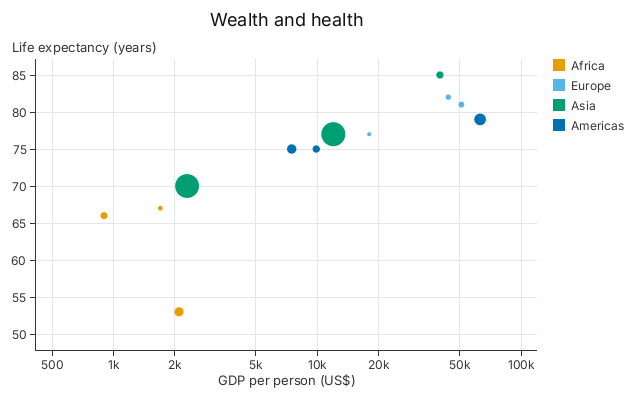
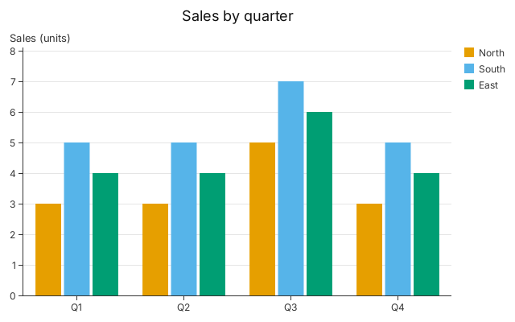

# Tutorial 1: Getting Started

> **Goal**: draw a scatter chart, a line chart and a bar chart from a `Vec` of
> your own structs, save them as PNG files and open them in a window.
>
> Every code block on this page is compiled and run by `cargo test --doc`, so
> what you copy is what works. Every image is a golden image checked by
> `tests/tutorials.rs`.

## What You Will Learn

- How to add Gup to a Rust project
- How a chart builder turns a `Vec` of your structs into a chart
- How to save a chart as a PNG and how to open it in a window
- How to colour marks by a category and size them by a value
- How to add titles and a grid
- How to draw line charts and bar charts

## Step 1: Set Up Your Project

Gup renders on the GPU through [wgpu](https://wgpu.rs/), so you need a computer
with a GPU wgpu supports (nearly every integrated and discrete GPU, and software
Vulkan drivers) and Rust 1.85 or newer, which is the first release with
edition 2024.

```bash
cargo new my-first-chart
cd my-first-chart
```

Add Gup to the `[dependencies]` of your `Cargo.toml`:

```toml
[dependencies]
gup = { git = "https://github.com/au-phiware/gup" }
```

Release 0.1 is not on crates.io yet, which is why the dependency names the
repository. There is nothing else to add: no async runtime, no GPU crate. Gup
creates its own GPU context.

## Step 2: Draw Your First Scatter Chart

A Gup chart starts from your data. Any `Vec` (or any iterator) of any type
works; Gup does not ask you to convert your rows into a table or a special
format. You tell the chart how to read each row with a closure, one per property
of the chart: where it goes, what colour it is, how big it is.

Replace `src/main.rs` with:

```rust
use gup::prelude::*;

struct Country {
    region: &'static str,
    gdp: f64,
    life: f64,
    people: f64,
}

fn main() -> gup::Result<()> {
    let countries = [
        ("Africa", 2.1e3, 53.0, 200e6),
        ("Africa", 1.7e3, 67.0, 54e6),
        ("Africa", 0.9e3, 66.0, 120e6),
        ("Europe", 5.1e4, 81.0, 83e6),
        ("Europe", 4.4e4, 82.0, 67e6),
        ("Europe", 1.8e4, 77.0, 38e6),
        ("Asia", 1.2e4, 77.0, 1400e6),
        ("Asia", 2.3e3, 70.0, 1380e6),
        ("Asia", 4.0e4, 85.0, 126e6),
        ("Americas", 6.3e4, 79.0, 330e6),
        ("Americas", 7.5e3, 75.0, 212e6),
        ("Americas", 9.9e3, 75.0, 128e6),
    ]
    .map(|(region, gdp, life, people)| Country { region, gdp, life, people });

    let mut chart = gup::scatter(countries)
        .x(|c| c.gdp)
        .y(|c| c.life);

    let cx = Context::shared()?;
    let image = chart.render(&cx, 640, 400)?;
    assert_eq!(image.dimensions(), (640, 400));
    Ok(())
}
```

Three things happened.

- `gup::scatter(countries)` took ownership of the rows and returned a _builder_.
  A builder is a chart: it has sensible defaults for everything you did not set
  (linear axes whose domains are fitted to your data, tick labels, a theme), so
  two closures are already a complete chart.
- `.x(|c| c.gdp)` and `.y(|c| c.life)` are the closures. They run once per row
  and return a number. The builder works out the numeric type from the return
  type, so `f64`, `f32`, integers and `Option`s of them all work.
- `chart.render(&cx, 640, 400)` drew the chart on the GPU into a 640 by 400
  `image::RgbaImage`. The `Context` is the connection to the GPU.
  `Context::shared()` creates it the first time and shares it afterwards, so
  every chart in your program, and every test, uses one device.

The chart is `let mut` because drawing it for the first time _resolves_ it: Gup
uploads your rows to the GPU, fits the axes to them and lays out the plot. That
work waits until the first draw, so building a chart is cheap and the order of
the builder calls does not matter.

## Step 3: Save a PNG, or Open a Window

To keep the picture, ask the chart to save itself. This writes `scatter.png` in
the directory you run it from:

```rust,no_run
use gup::prelude::*;

fn main() -> gup::Result<()> {
    let cx = Context::shared()?;
    let mut chart = gup::scatter([(1.0, 2.0), (2.0, 5.0), (3.0, 3.0)])
        .x(|p| p.0)
        .y(|p| p.1);
    chart.save_png(&cx, "scatter.png", 640, 400)?;
    Ok(())
}
```

(Rows can be tuples, as here, when you do not want a struct.)

To look at a chart and interact with it, hand it to `gup::show`, which opens a
window, draws the chart in it and returns when you close the window. The mouse
wheel zooms, a drag pans, and the chart follows the window's size:

```rust,no_run
fn main() -> gup::Result<()> {
    let chart = gup::scatter([(1.0, 2.0), (2.0, 5.0), (3.0, 3.0)])
        .x(|p| p.0)
        .y(|p| p.1);
    gup::show(chart)
}
```

`show` is the only function in this tutorial that needs a display, which is why
the examples below save PNGs, and why your own tests can too.

## Step 4: Colour by Key, Size by Value

A scatter chart earns its keep when it shows more than two numbers per row. Two
more closures add two:

- `.color(|c| c.region)` colours each mark by a _category_. Rows with equal keys
  share a colour, taken in order of first appearance from a palette that stays
  distinguishable for colour-blind readers (Okabe-Ito), and the chart gains a
  legend that lists the keys.
- `.size(|c| c.people)` sizes each mark by a _value_. The radius follows the
  square root of the value, so the _area_ of a disc is proportional to it, which
  is what the eye reads. Radii run from 2 to 12 pixels.

A key can be anything that is `Hash + Eq + Clone + Display`: a string, an
integer or an enum. The closure returns an owned key, so for a `String` field
write `c.region.clone()`; `c.region.as_str()` does not compile. (The reason is
in the "Category keys" section of the `gup_core::builder` docs.)

```rust
use gup::prelude::*;

struct Country {
    region: &'static str,
    gdp: f64,
    life: f64,
    people: f64,
}

fn main() -> gup::Result<()> {
    let countries = [
        ("Africa", 2.1e3, 53.0, 200e6),
        ("Africa", 1.7e3, 67.0, 54e6),
        ("Africa", 0.9e3, 66.0, 120e6),
        ("Europe", 5.1e4, 81.0, 83e6),
        ("Europe", 4.4e4, 82.0, 67e6),
        ("Europe", 1.8e4, 77.0, 38e6),
        ("Asia", 1.2e4, 77.0, 1400e6),
        ("Asia", 2.3e3, 70.0, 1380e6),
        ("Asia", 4.0e4, 85.0, 126e6),
        ("Americas", 6.3e4, 79.0, 330e6),
        ("Americas", 7.5e3, 75.0, 212e6),
        ("Americas", 9.9e3, 75.0, 128e6),
    ]
    .map(|(region, gdp, life, people)| Country { region, gdp, life, people });

    let mut chart = gup::scatter(countries)
        .x(|c| c.gdp)
        .y(|c| c.life)
        .color(|c| c.region)
        .size(|c| c.people);

    let image = chart.render(&Context::shared()?, 640, 400)?;
    assert_eq!(image.dimensions(), (640, 400));
    Ok(())
}
```

## Step 5: Titles, a Grid and a Log Scale

Axis titles and a grid make a chart readable without you standing next to it.
These are _plot-level_ setters: they apply to the whole chart, and unlike the
per-mark setters above they work at any time, even after the first draw.

GDP spans two orders of magnitude, so most countries would crowd the left edge
of a linear axis. `.x_scale(Log::new())` swaps in a logarithmic scale. The
domain is still fitted to the data.

```rust
use gup::prelude::*;

struct Country {
    region: &'static str,
    gdp: f64,
    life: f64,
    people: f64,
}

fn main() -> gup::Result<()> {
    let countries = [
        ("Africa", 2.1e3, 53.0, 200e6),
        ("Africa", 1.7e3, 67.0, 54e6),
        ("Africa", 0.9e3, 66.0, 120e6),
        ("Europe", 5.1e4, 81.0, 83e6),
        ("Europe", 4.4e4, 82.0, 67e6),
        ("Europe", 1.8e4, 77.0, 38e6),
        ("Asia", 1.2e4, 77.0, 1400e6),
        ("Asia", 2.3e3, 70.0, 1380e6),
        ("Asia", 4.0e4, 85.0, 126e6),
        ("Americas", 6.3e4, 79.0, 330e6),
        ("Americas", 7.5e3, 75.0, 212e6),
        ("Americas", 9.9e3, 75.0, 128e6),
    ]
    .map(|(region, gdp, life, people)| Country { region, gdp, life, people });

    let mut chart = gup::scatter(countries)
        .x(|c| c.gdp)
        .y(|c| c.life)
        .color(|c| c.region)
        .size(|c| c.people)
        .x_scale(Log::new())
        .title("Wealth and health")
        .x_title("GDP per person (US$)")
        .y_title("Life expectancy (years)")
        .grid(Axes::Both);

    let image = chart.render(&Context::shared()?, 640, 400)?;
    assert_eq!(image.dimensions(), (640, 400));
    Ok(())
}
```

Save that with `chart.save_png(&cx, "scatter.png", 640, 400)?` and you get
twelve discs in four colours on a logarithmic GDP axis, under a title, with a
grid and a legend of the four regions:



The two Asian discs are the largest because their populations are, and the
legend names the four regions the colours stand for. `Axes::X`, `Axes::Y` and
`Axes::Both` choose which axes get grid lines; the default is none.

## Step 6: A Line Chart

`gup::line` draws a polyline through rows _in the order you give them_, so sort
your rows by x first. Colouring by a key draws one line per key, in the same
palette and with the same kind of legend as the scatter chart.

A missing value breaks the line instead of being guessed. Make the `y` closure
return an `Option<f64>`: `None` (and NaN) leaves a gap, which is the honest way
to show a day with no reading.

```rust
use gup::prelude::*;

struct Price {
    day: f64,
    ticker: &'static str,
    price: Option<f64>,
}

fn main() -> gup::Result<()> {
    let prices = (0..20).flat_map(|day| {
        ["AAA", "BBB"].map(|ticker| Price {
            day: f64::from(day),
            ticker,
            // The market was closed on day 8: no price, so a gap.
            price: (day != 8).then(|| {
                f64::from(day) * 1.5 + if ticker == "AAA" { 10.0 } else { 0.0 }
            }),
        })
    });

    let mut chart = gup::line(prices)
        .x(|p| p.day)
        .y(|p| p.price)
        .color(|p| p.ticker)
        .title("Closing prices")
        .x_title("Day")
        .y_title("Price")
        .grid(Axes::Y);

    let image = chart.render(&Context::shared()?, 640, 400)?;
    assert_eq!(image.dimensions(), (640, 400));
    Ok(())
}
```

## Step 7: A Bar Chart

`gup::bar` puts one bar per row on a _band_ axis of categories. The `x` closure
returns the category (a key, like the colour above) and `y` the height. Rows
that share a category share a slot on the axis; what happens to them is your
choice:

- `.group(|s| s.region)` puts them side by side, one bar per key, coloured by
  key.
- `.stack(|s| s.region)` puts them on top of each other, so the bar's total
  height is the sum.

Use `group` to compare the parts, and `stack` to show the whole. The last of the
two that you call wins. Bars start at zero, so the value axis always includes
zero.

```rust
use gup::prelude::*;

struct Sale {
    quarter: &'static str,
    region: &'static str,
    total: f64,
}

fn main() -> gup::Result<()> {
    let sales = ["Q1", "Q2", "Q3", "Q4"].into_iter().flat_map(|quarter| {
        [("North", 3.0), ("South", 5.0), ("East", 4.0)].map(|(region, base)| Sale {
            quarter,
            region,
            total: base + if quarter == "Q3" { 2.0 } else { 0.0 },
        })
    });

    let mut chart = gup::bar(sales)
        .x(|s| s.quarter)
        .y(|s| s.total)
        .group(|s| s.region)
        .title("Sales by quarter")
        .y_title("Sales (units)")
        .grid(Axes::Y);

    let image = chart.render(&Context::shared()?, 640, 400)?;
    assert_eq!(image.dimensions(), (640, 400));
    Ok(())
}
```

The result is four groups of three bars, one group per quarter, with a legend
for the regions:



Change `.group` to `.stack` and the three bars in each quarter become one tall
bar made of three coloured parts.

## Other Chart Types

Scatter, line and bar are the builders available today. Area charts, histograms,
heatmaps and annotations arrive with track N2 of the
[strategic review](../planning/STRATEGIC_REVIEW_2026-10.md), and this page will
gain a tour of them when they do. Until then, anything the builders cannot say
you can build from the same marks one level down, which is the next tutorial.

## Where Next

You can now draw the three common charts from your own data. The tutorials
continue:

- [Tutorial 2: Plots and Selections](02_data_binding.md) shows what a builder is
  made of, how to put several layers on shared axes, and how colour and size
  scales work.
- [Tutorial 3: Custom Shader Functions](03_custom_shader_functions.md) writes
  your own GPU encodings.
- [Tutorial 4: Interactions](04_interactions.md) adds hover, selection, brushing
  and zoom.
- [Tutorial 5: Streaming Data](05_streaming_data.md) appends rows to a running
  chart.
- [Tutorial 6: Custom Marks](06_custom_marks.md) defines a new mark.

Tutorials 3 to 6 are being rewritten; their banners say so.
