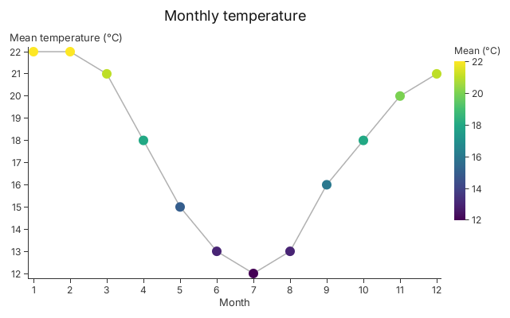

# Tutorial 2: Plots and Selections

> **Goal**: understand what a chart builder is made of, so that you can draw
> things the builders do not: several kinds of mark on shared axes, a second y
> axis, your own colour scales.
>
> Every code block on this page is compiled and run by `cargo test --doc`,
> except the one marked `compile_fail`, which is checked to be rejected. Every
> image is a golden image checked by `tests/tutorials.rs`.

## What You Will Learn

- How to drop from a builder to its `Plot` and its layers
- How to build a `Plot` from layers of circles, lines, segments and rectangles
- How the plot's scales are shared by every layer, and how to encode through
  them
- How to colour marks through a colour scale and get a legend
- Why the compiler rejects a colour where a size belongs
- How to draw a second y axis, and how much data a layer keeps

## Prerequisites

Tutorial 1: you can draw a chart with `gup::scatter`, `gup::line` or `gup::bar`.

## The Parts of a Chart

A builder like `gup::scatter` is thin. Underneath, every chart is a `Plot`:

- A **`Plot`** owns the axes (an x scale, a y scale and optionally a second y
  scale), the title, the legends, the theme, and a list of layers. It lays all
  of them out in the picture.
- A **layer** is a `Selection<T, M>`: your rows (`T`) drawn with one kind of
  mark (`M`), such as a `Circle`, a `Line`, a `Segment` or a `Rect`. The `M` is
  a type, not a value, so the compiler knows which channels the mark has and
  what type each channel takes.
- A **channel** is one visual property of a mark, such as `Circle::X`,
  `Circle::RADIUS` or `Circle::FILL`. A channel is driven by a constant
  (`Px(4.0)`) or by an _encoding_: a closure that reads a row, followed by a
  scale that turns its result into a pixel position, a size or a colour.
- A **scale** is shared. Every layer that encodes through the plot's x scale
  agrees where `month 6` is, which is how a line, its markers and its error bars
  line up.

A builder is a `Plot` with one layer (or a layer per key) and some setters that
fill in the channels for you. You can drop down to the plot at any time.

## Step 1: Drop From a Builder to Its Plot

A builder keeps its layer setters (`x`, `y`, `color`, ...) for the first draw.
After that, and for anything the builder has no setter for, use `layer_mut`,
`layers_mut` and `into_plot`.

`ScatterChart::layer_mut` borrows its one `Selection<T, Circle>`. The scatter
builder has no stroke setter, but the `Circle` mark has a stroke, so:

```rust
use gup::prelude::*;

fn main() -> gup::Result<()> {
    let mut chart = gup::scatter([(1.0, 2.0), (2.0, 5.0), (3.0, 3.0)])
        .x(|p| p.0)
        .y(|p| p.1);

    chart
        .layer_mut()
        .stroke(Color::hex(0x000000))
        .stroke_width(Px(1.5));

    let image = chart.render(&Context::shared()?, 640, 400)?;
    assert_eq!(image.dimensions(), (640, 400));
    Ok(())
}
```

A line chart has a layer per colour key, so `LineChart::layers_mut` visits all
of them. (Here `.width(Px(3.0))` does what the builder's own `.width(3.0)` does.
The loop is the general form, for channels with no builder setter.)

```rust
use gup::prelude::*;

fn main() -> gup::Result<()> {
    let mut chart = gup::line([("a", 0.0, 1.0), ("a", 1.0, 3.0), ("b", 0.0, 2.0), ("b", 1.0, 1.0)])
        .x(|r| r.1)
        .y(|r| r.2)
        .color(|r| r.0);

    for layer in chart.layers_mut() {
        layer.width(Px(3.0));
    }

    let image = chart.render(&Context::shared()?, 640, 400)?;
    assert_eq!(image.dimensions(), (640, 400));
    Ok(())
}
```

`into_plot` consumes the builder and gives you its `Plot`, to which you can add
more layers. The builder's scales stay, so the new layer shares its axes:

```rust
use gup::prelude::*;

fn main() -> gup::Result<()> {
    let chart = gup::scatter([(1.0, 2.0), (2.0, 5.0), (3.0, 3.0)])
        .x(|p| p.0)
        .y(|p| p.1);

    let mut plot: Plot = chart.into_plot();
    plot.line([(1.0, 2.0), (3.0, 4.0)]).x(|p| p.0).y(|p| p.1);

    let image = plot.render(&Context::shared()?, 640, 400)?;
    assert_eq!(image.dimensions(), (640, 400));
    Ok(())
}
```

## Step 2: Build a Plot From Layers

`Plot::new()` starts with automatic linear scales. Each of `circles`, `line`,
`segments` and `rects` adds a layer over your rows and returns it, so the
channels of the mark are set by chained calls. Position closures (`.x(..)`,
`.y(..)`, `.x_end(..)` and `.y_end(..)`) are encoded through the plot's own
scale for that axis, which is why they need no scale argument.

Layers are drawn in the order they are added, so the first is at the back. This
chart of monthly temperatures has a shaded band for winter at the back, then a
range per month as vertical segments, then the mean as a line and as circles:

```rust
use gup::prelude::*;

#[derive(Clone)]
struct Month {
    n: f64,
    mean: f64,
    lo: f64,
    hi: f64,
}

fn main() -> gup::Result<()> {
    let months = [
        (1.0, 22.0, 19.0, 26.0),
        (2.0, 22.0, 19.0, 26.0),
        (3.0, 21.0, 18.0, 25.0),
        (4.0, 18.0, 15.0, 22.0),
        (5.0, 15.0, 12.0, 19.0),
        (6.0, 13.0, 9.0, 17.0),
        (7.0, 12.0, 8.0, 16.0),
        (8.0, 13.0, 9.0, 18.0),
        (9.0, 16.0, 12.0, 21.0),
        (10.0, 18.0, 14.0, 23.0),
        (11.0, 20.0, 16.0, 24.0),
        (12.0, 21.0, 18.0, 25.0),
    ]
    .map(|(n, mean, lo, hi)| Month { n, mean, lo, hi });

    let mut plot = Plot::new();
    plot.title("Monthly temperature");

    // Winter: months 5.5 to 8.5, from the bottom to the top of the data.
    plot.rects([(5.5, 8.5)])
        .x(|w| w.0)
        .x_end(|w| w.1)
        .y(|_| 0.0)
        .y_end(|_| 30.0)
        .fill(Color::hex(0xe3ebf6));

    // The range of each month: a vertical segment from the low to the high.
    plot.segments(months.clone())
        .x(|m| m.n)
        .x_end(|m| m.n)
        .y(|m| m.lo)
        .y_end(|m| m.hi)
        .width(Px(3.0))
        .color(Color::hex(0xb0b0b0));

    plot.line(months.clone()).x(|m| m.n).y(|m| m.mean);
    plot.circles(months).x(|m| m.n).y(|m| m.mean).radius(Px(4.0));

    let image = plot.render(&Context::shared()?, 640, 400)?;
    assert_eq!(image.dimensions(), (640, 400));
    Ok(())
}
```

Notice that:

- The four layers have different mark types and (for the band) a different row
  type, yet they share one pair of axes. The plot fits each scale's domain to
  the union of everything encoded through it.
- A constant closure such as `.y(|_| 0.0)` is how you place a mark at a fixed
  data value, here the edges of the band.
- A mark's setters (`.radius(Px(4.0))`, `.width(Px(3.0))`, `.fill(..)`) take a
  constant. A closure is for per-row values.

## Step 3: Scales and Handles

`plot.x(scale)` and `plot.y(scale)` replace the automatic scale with one you
configure, and return a handle (a `ScaleRef`) to it. The handle is how you
encode explicitly, which is what the plain `.x(|m| m.n)` setter did for you:

```rust
use gup::prelude::*;

struct Month {
    n: f64,
    mean: f64,
}

fn main() -> gup::Result<()> {
    let months = vec![
        Month { n: 1.0, mean: 22.0 },
        Month { n: 7.0, mean: 12.0 },
        Month { n: 12.0, mean: 21.0 },
    ];

    let mut plot = Plot::new();
    let x = plot.x(Linear::new().domain(0.0, 13.0));
    let y = plot.y(Linear::new().domain(0.0, 30.0));

    plot.add(Selection::<Month, Circle>::new(months))
        .attr(Circle::X, x.encode(|m: &Month| m.n))
        .attr(Circle::Y, y.encode(|m: &Month| m.mean))
        .attr(Circle::RADIUS, Px(4.0));

    let image = plot.render(&Context::shared()?, 640, 400)?;
    assert_eq!(image.dimensions(), (640, 400));
    Ok(())
}
```

`attr(channel, encoding)` is the one call under every setter. Its second
argument is either a constant of the channel's type (`Px(4.0)`) or the result of
`scale.encode(closure)`. Spelling it out is worth it when you want a different
scale per layer (a log scale for one, a linear one for another) or when the
channel has no shortcut.

Why the typed closure parameter (`|m: &Month|`)? rustc learns the row type from
`attr`'s bounds, which it checks after the closure, so it cannot infer it there.
The shortcut setters (`.x(|m| m.n)`) already know the row type, which is why
they do not need it.

### Categories: `Band` and `encode_key`

A categorical axis uses a `Band` scale, which gives each distinct key its own
slot, in the order the keys first appear. Its closure returns a key rather than
a number, so you encode through it with `encode_key`, and the bars take their
width from the band:

```rust
use gup::prelude::*;

struct Rain {
    month: &'static str,
    mm: f64,
}

fn main() -> gup::Result<()> {
    let rain = vec![
        Rain { month: "Jan", mm: 90.0 },
        Rain { month: "Feb", mm: 120.0 },
        Rain { month: "Mar", mm: 130.0 },
    ];

    let mut plot = Plot::new();
    let x = plot.x(Band::new());
    plot.y(Linear::new().domain(0.0, 150.0));

    plot.add(Selection::<Rain, Rect>::new(rain))
        .attr(Rect::X, x.encode_key(|r: &Rain| r.month))
        .attr(Rect::WIDTH, x.band_width_px())
        .y(|r| r.mm)
        .y_end(|_| 0.0);

    let image = plot.render(&Context::shared()?, 640, 400)?;
    assert_eq!(image.dimensions(), (640, 400));
    Ok(())
}
```

This is what `gup::bar` does for you, plus grouping and stacking.

## Step 4: Colour Through a Scale

A colour is a channel like any other, so it is driven by a scale whose output is
a `Color`. `Sequential::viridis()` maps a number onto the viridis ramp. Hand it
to `encode` and the circles are coloured by the value, and the plot draws a
legend of the ramp, with the title you give it:

```rust
use gup::prelude::*;

#[derive(Clone)]
struct Month {
    n: f64,
    mean: f64,
}

fn main() -> gup::Result<()> {
    let months = [
        (1.0, 22.0),
        (2.0, 22.0),
        (3.0, 21.0),
        (4.0, 18.0),
        (5.0, 15.0),
        (6.0, 13.0),
        (7.0, 12.0),
        (8.0, 13.0),
        (9.0, 16.0),
        (10.0, 18.0),
        (11.0, 20.0),
        (12.0, 21.0),
    ]
    .map(|(n, mean)| Month { n, mean });

    let mut plot = Plot::new();
    plot.title("Monthly temperature")
        .x_title("Month")
        .y_title("Mean temperature (°C)");
    let (x, y) = (plot.x(Linear::new()), plot.y(Linear::new()));
    let heat = Sequential::viridis();

    plot.line(months.clone())
        .x(|m| m.n)
        .y(|m| m.mean)
        .color(Color::hex(0xb0b0b0));
    plot.add(Selection::<Month, Circle>::new(months))
        .attr(Circle::X, x.encode(|m: &Month| m.n))
        .attr(Circle::Y, y.encode(|m: &Month| m.mean))
        .attr(Circle::FILL, heat.encode(|m: &Month| m.mean))
        .attr(Circle::RADIUS, Px(6.0))
        .legend_title(Circle::FILL, "Mean (°C)");

    let image = plot.render(&Context::shared()?, 640, 400)?;
    assert_eq!(image.dimensions(), (640, 400));
    Ok(())
}
```



A grey line passes through twelve circles, which run from yellow (warm) to
purple (cool) along the viridis ramp, with a colour bar for them on the right.
The line is at the back because it was added first.

### What the compiler catches

Each channel has a type, and each scale has an output type. `Circle::FILL` is a
`Color` and `Circle::RADIUS` is a `Px`. A `Sequential` scale produces colours,
so it cannot drive a radius. This is a compile error, not a wrong picture:

```rust,compile_fail
use gup::prelude::*;

struct Month {
    mean: f64,
}

fn main() {
    let mut plot = Plot::new();
    let heat = Sequential::viridis();
    plot.add(Selection::<Month, Circle>::new(vec![Month { mean: 22.0 }]))
        .attr(Circle::RADIUS, heat.encode(|m: &Month| m.mean));
}
```

rustc reports a type mismatch ("expected `Px`, found `Color`") and points at the
`encode` call. A `Px` channel takes a constant `Px(3.0)` or the output of a
scale that produces pixels, such as a `Pow` scale with a pixel range, which is
what the scatter builder's `.size(..)` uses. Catching this at compile time is
the reason channels and scales are typed.

## Step 5: A Second Y Axis

Two quantities of different units do not share a y scale. `plot.y_right(scale)`
adds a second y axis on the right of the plot and returns its handle. The plain
closure setters (`.y(|m| ..)`) still bind to the left axis, so a layer for the
right axis is encoded through the handle:

```rust
use gup::prelude::*;

#[derive(Clone)]
struct Month {
    n: f64,
    temp: f64,
    rain: f64,
}

fn main() -> gup::Result<()> {
    let months: Vec<Month> = (1..=12)
        .map(|n| Month {
            n: f64::from(n),
            temp: 8.0 + f64::from(n),
            rain: 20.0 * f64::from(n),
        })
        .collect();

    let mut plot = Plot::new();
    let x = plot.x(Linear::new());
    plot.y(Linear::new());
    let right = plot.y_right(Linear::new());
    plot.y_title("Temperature (°C)")
        .y_right_title("Rainfall (mm)");

    // Temperature on the left axis, as before.
    plot.line(months.clone()).x(|m| m.n).y(|m| m.temp);

    // Rainfall on the right axis, through its handle.
    plot.add(Selection::<Month, Circle>::new(months))
        .attr(Circle::X, x.encode(|m: &Month| m.n))
        .attr(Circle::Y, right.encode(|m: &Month| m.rain))
        .attr(Circle::RADIUS, Px(4.0));

    let image = plot.render(&Context::shared()?, 640, 400)?;
    assert_eq!(image.dimensions(), (640, 400));
    Ok(())
}
```

Zooming and panning move both y axes together, and only the left axis draws grid
lines.

## Step 6: What a Layer Keeps

After your rows are on the GPU, a layer decides how much of the CPU copy to
keep: `Retain::Auto` (the default) keeps everything up to 10 million rows, which
is what hover, tooltips, vector export and re-encoding a channel need, and
`Retain::GpuOnly` keeps only column statistics, which is what a very large chart
wants. `Rows` and `Columns` keep one of the two. The trade is memory against
features, set per layer with `layer.retain(Retain::GpuOnly)`.

## Where Next

- [Tutorial 3: Custom Shader Functions](03_custom_shader_functions.md)
- [Tutorial 4: Interactions](04_interactions.md)
