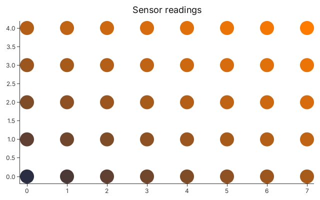

# Tutorial 3: Custom Shader Functions

> **Goal**: write your own colour or size function in WGSL, so that your data
> reaches the screen through a scale the library does not have: a seismic energy
> law, a house colour ramp, a transfer function from your field.
>
> Every code block on this page is compiled and run by `cargo test --doc`,
> except the one marked `compile_fail`, which is checked to be rejected. Every
> image is a golden image checked by `tests/tutorials.rs`.

## What You Will Learn

- What a shader function is, and why each one has an f64 twin
- How to chain the built-in scales with `.then(..)`
- How to write your own with `#[wgsl_function]`, and use it on a channel
- How to size marks through a chain that starts with your function
- What the compiler tells you when your WGSL is wrong
- How to keep the WGSL in a file

## Prerequisites

Tutorial 2: you can build a `Plot` and encode a channel through a scale.

## What a Shader Function Is

In Tutorial 2 you wrote `heat.encode(|m| m.mean)`. The closure reads a number
from your row. The scale, `heat`, turns that number into a colour. Gup does not
run the scale in Rust for every row. It uploads the numbers once and runs the
scale on the GPU, in the vertex shader, as part of drawing. That is why zooming
a million points is cheap: nothing is recomputed on the CPU.

So every scale is a **shader function**: one WGSL function, plus a small uniform
of values it reads (its `Params`: a domain, a range, an exponent). Your own
functions are the same kind of thing as `Log`, `Pow` and `Sequential`, and they
work anywhere those work.

A GPU function alone is not enough, though. The axes need tick positions, the
legend needs swatches, a hover needs the row under the pointer, and an SVG
export needs the colours as numbers, and none of those run on the GPU. So each
shader function can have a **CPU mirror**: the same function written again in
Rust, on `f64`. When you write the WGSL and the mirror, you promise they agree,
and then the axes, legends, picking and SVG agree with the pixels.

## Step 1: Chain the Built-in Scales

Before you write anything, see how far composing gets you. Suppose your values
span many orders of magnitude, such as the energies of earthquakes. A colour
scale straight on the values would colour nearly every quake the same. Take the
logarithm first, then the colour scale. `.then(..)` does that in one expression:

```rust
use gup::prelude::*;

struct Quake {
    lon: f64,
    lat: f64,
    joules: f64,
}

fn main() -> gup::Result<()> {
    let quakes = vec![
        Quake { lon: 142.4, lat: 38.3, joules: 1.5e17 },
        Quake { lon: 142.9, lat: 38.0, joules: 2.8e14 },
        Quake { lon: 141.8, lat: 37.6, joules: 1.1e13 },
        Quake { lon: 142.1, lat: 38.9, joules: 3.9e11 },
        Quake { lon: 143.2, lat: 37.9, joules: 7.9e12 },
    ];

    // Logarithm first, then viridis: `viridis(log(joules))`.
    let by_energy = Log::new().then(Sequential::viridis());

    let mut plot = Plot::new();
    let (x, y) = (plot.x(Linear::new()), plot.y(Linear::new()));
    plot.add(Selection::<Quake, Circle>::new(quakes))
        .attr(Circle::X, x.encode(|q: &Quake| q.lon))
        .attr(Circle::Y, y.encode(|q: &Quake| q.lat))
        .attr(Circle::RADIUS, Px(8.0))
        .attr(Circle::FILL, by_energy.encode(|q: &Quake| q.joules));

    let image = plot.render(&Context::shared()?, 640, 400)?;
    assert_eq!(image.dimensions(), (640, 400));
    Ok(())
}
```

`Log::new()` and `Sequential::viridis()` have no domain here, so Gup fits them:
the log scale to the smallest and largest energy in your data, and the viridis
scale to the logarithms of those. That works because the first link in a chain
has a CPU mirror, which can say what the data's extent turns into. Both links
run in one GPU expression, and each keeps its own entry in the layer's uniform.

The rule for a chain is that each link's output must be the next link's input: a
number into a number, and a pixel size (`Px`) also into a number. A colour scale
produces a colour, so it ends a chain.

## Step 2: Write Your Own

Now a colour ramp the library does not have. The ramp mixes between a cold and a
hot colour, and a `bend` makes the middle of the range lean to one end. The WGSL
goes in an attribute on an `impl ShaderFn` block, and the rest of the block is
Rust.

```rust
use gup::prelude::*;

/// A ramp from `cold` to `hot`; `bend` below 1 reaches `hot` sooner.
#[derive(Clone, Debug)]
struct Ember {
    cold: Color,
    hot: Color,
    bend: f32,
}

#[gup::wgsl_function(path = "tutorial3_ember", wgsl = r#"
    struct Params { cold: vec4<f32>, hot: vec4<f32>, bend: f32 }

    fn ember(t: f32, p: Params) -> vec4<f32> {
        let k = pow(clamp(t, 0.0, 1.0), p.bend);
        return mix(p.cold, p.hot, k);
    }
"#)]
impl ShaderFn for Ember {
    fn params(&self) -> EmberParams {
        EmberParams { cold: self.cold, hot: self.hot, bend: self.bend }
    }
}

// The same function on the CPU, in f64.
impl CpuMirror for Ember {
    fn eval(&self, t: f64) -> Color {
        let k = t.clamp(0.0, 1.0).powf(f64::from(self.bend)) as f32;
        let mix = |a: f32, b: f32| a + (b - a) * k;
        Color {
            r: mix(self.cold.r, self.hot.r),
            g: mix(self.cold.g, self.hot.g),
            b: mix(self.cold.b, self.hot.b),
            a: mix(self.cold.a, self.hot.a),
        }
    }
}

struct Reading {
    x: f64,
    y: f64,
    level: f64,
}

fn main() -> gup::Result<()> {
    // An 8 by 5 grid of readings, hotter towards the top right.
    let readings: Vec<Reading> = (0..40)
        .map(|i| {
            let (x, y) = (f64::from(i % 8), f64::from(i / 8));
            Reading { x, y, level: (x + 2.0 * y) / 15.0 }
        })
        .collect();

    let ember = Ember {
        cold: Color::hex(0x2b2d42),
        hot: Color::hex(0xff7b00),
        bend: 0.7,
    };

    let mut plot = Plot::new();
    plot.title("Sensor readings");
    let (x, y) = (plot.x(Linear::new()), plot.y(Linear::new()));
    plot.add(Selection::<Reading, Circle>::new(readings))
        .attr(Circle::X, x.encode(|r: &Reading| r.x))
        .attr(Circle::Y, y.encode(|r: &Reading| r.y))
        .attr(Circle::RADIUS, Px(14.0))
        .attr(Circle::FILL, ember.encode(|r: &Reading| r.level));

    let image = plot.render(&Context::shared()?, 640, 400)?;
    assert_eq!(image.dimensions(), (640, 400));
    Ok(())
}
```

Take the block apart:

- **The WGSL** is the string. It has the same two parts every shader function
  has: a `struct Params`, which is the uniform the function reads, and the
  function itself. Its first argument is the value from your row (`t`) and its
  last is the `Params`. Its return type, `vec4<f32>`, makes this function
  produce a colour; `f32` would make it produce a number.
- **`params()`** returns `EmberParams`, a struct the macro generates from your
  `Params`, with one public field per member. A `vec4<f32>` member is a `Color`
  on the Rust side. Gup calls `params()` when it prepares the layer and uploads
  the result. Change a field of `Ember` and the next frame uses it.
- **`path = "tutorial3_ember"`** names the WGSL module the macro creates. By
  default the name is your crate's name plus the type's, which is right in your
  own project. Documentation tests are compiled in a crate named after `gup`
  itself, and the `gup::` namespace belongs to the library, so a doctest must
  choose its own path. In your project you may leave `path` out.
- **`impl CpuMirror`** is the f64 twin. For a colour function it returns the
  `Color` your WGSL computes, so a legend or an SVG export can show the same
  colour the GPU draws.

Everything else is derived by the macro from the WGSL: the input and output
types, the entry point and the module. You never write a vertex layout or a
binding.



The circles run from the dark `cold` colour at the bottom left to the orange
`hot` colour at the top right, and because `bend` is below 1 they reach orange a
little sooner than a straight mix would. The muddy middle is what mixing two
colours component by component in sRGB gives; if you want a livelier ramp, that
is a change to the WGSL (mix in another space, or add a middle colour), and
nothing else in your program changes.

## Step 3: Start a Chain with Your Function

A function that returns a number can start a chain, so that your law feeds a
library scale. The energy an earthquake releases grows by a factor of about 32
for each whole step of magnitude: log₁₀ E = 1.5 M + 4.8. Write that as a shader
function, and size each quake's disc by the energy it released, through a
square-root scale so that the disc's _area_ follows the energy:

```rust
use gup::prelude::*;

/// The energy an earthquake releases, in joules, from its magnitude.
#[derive(Clone, Debug)]
struct Energy;

#[gup::wgsl_function(path = "tutorial3_energy", monotonic, wgsl = r#"
    struct Params { slope: f32, offset: f32 }

    fn energy(magnitude: f32, p: Params) -> f32 {
        return pow(10.0, p.slope * magnitude + p.offset);
    }
"#)]
impl ShaderFn for Energy {
    fn params(&self) -> EnergyParams {
        EnergyParams { slope: 1.5, offset: 4.8 }
    }
}

impl CpuMirror for Energy {
    fn eval(&self, magnitude: f64) -> f64 {
        10f64.powf(1.5 * magnitude + 4.8)
    }
}

struct Quake {
    lon: f64,
    lat: f64,
    magnitude: f64,
}

fn main() -> gup::Result<()> {
    let quakes = vec![
        Quake { lon: 142.4, lat: 38.3, magnitude: 7.8 },
        Quake { lon: 142.9, lat: 38.0, magnitude: 6.1 },
        Quake { lon: 141.8, lat: 37.6, magnitude: 5.2 },
        Quake { lon: 142.1, lat: 38.9, magnitude: 4.4 },
    ];

    // Energy first, then a square root onto a radius between 0 and 30 px.
    // The square root's domain is fitted to the image of the data's extent
    // through `Energy`, so the largest quake gets the full 30 px.
    let radius = Energy.then(Pow::sqrt().range(Px(0.0), Px(30.0)));
    // The mirror is what an axis or a legend would call.
    assert!((Energy.eval(7.8) / 10f64.powf(16.5) - 1.0).abs() < 1e-9);

    let mut plot = Plot::new();
    let (x, y) = (plot.x(Linear::new()), plot.y(Linear::new()));
    plot.add(Selection::<Quake, Circle>::new(quakes))
        .attr(Circle::X, x.encode(|q: &Quake| q.lon))
        .attr(Circle::Y, y.encode(|q: &Quake| q.lat))
        .attr(Circle::RADIUS, radius.encode(|q: &Quake| q.magnitude));

    let image = plot.render(&Context::shared()?, 640, 400)?;
    assert_eq!(image.dimensions(), (640, 400));
    Ok(())
}
```

Two details are worth knowing.

First, `Energy` needed its CPU mirror because it _starts_ a chain: the square
root's automatic domain is the range of the data _after_ `Energy`, and only the
mirror can compute that before anything is drawn. The same mirror is what
`Energy.eval(7.8)` calls on the CPU, which the assertion in the block checks.

Second, `monotonic` promises that `Energy` never decreases as its input grows.
Gup uses that to find the biggest disc your data will draw and make room for it
at the edge of the plot (otherwise a disc at the corner could be clipped). The
macro derives this from your mirror, so it is only accepted on a function that
has one. Every library scale is monotonic; leave `monotonic` off if yours is
not, and the plot will then simply not reserve that room.

## Step 4: When the WGSL Is Wrong

Gup checks your WGSL when your crate compiles, not when the first frame is
drawn. The attribute composes the module with the library's WGSL and reports
errors as compile errors, with the line of the WGSL they are on. Here the
semicolon after `p.gamma` is missing:

```rust,compile_fail
use gup::prelude::*;

#[derive(Clone)]
struct Gamma;

#[gup::wgsl_function(path = "tutorial3_gamma", wgsl = r#"
    struct Params { gamma: f32 }

    fn gamma(t: f32, p: Params) -> f32 {
        let g = p.gamma
        return pow(t, g);
    }
"#)]
impl ShaderFn for Gamma {
    fn params(&self) -> GammaParams {
        GammaParams { gamma: 2.2 }
    }
}

fn main() {}
```

`cargo build` stops with `expected ';', found "return"`, an arrow pointing at
the `return` line inside the string. The same check catches a wrong number of
arguments, an unknown import, a `Params` member with no twin in `params()`, a
signature the glue cannot call, and operations that the vertex stage does not
have, such as `textureSample`. What the compiler cannot know is whether your
mirror agrees with your WGSL, so test that yourself: render a chart and compare
a pixel with `eval`, as the tests in the Gup repository do.

## Step 5: Keep the WGSL in a File

A long function reads better as a `.wgsl` file with editor support. Give the
attribute `file = "…"` instead of `wgsl = "…"`, with a path relative to your
crate's `Cargo.toml`:

```text
my-project/
├── Cargo.toml
└── src/
    ├── main.rs
    └── ember.wgsl
```

and in `src/main.rs`, `#[gup::wgsl_function(file = "src/ember.wgsl")]` above the
same `impl ShaderFn for Ember` block, with the contents of the string from Step
2 in `ember.wgsl`. The file is read when the crate compiles, and cargo rebuilds
the crate when it changes. Everything else is identical. A documentation test
has no crate files of its own, which is why this page shows the file in words
instead of a block you could run.

The file may also `#import` from Gup's own WGSL library (for example
`#import gup::scale::linear as linear`), and may hold helper functions. If it
holds more than one function, `entry = "ember"` says which one Gup calls.

## Where Next

- [Tutorial 4: Interactions](04_interactions.md)
- [Tutorial 6: Custom Marks](06_custom_marks.md): when the shape itself is new,
  not only its colour or size
- The `wgsl_function` page of the API reference lists every signature the
  attribute accepts, including dictionary codes and palettes with a lookup
  texture.
