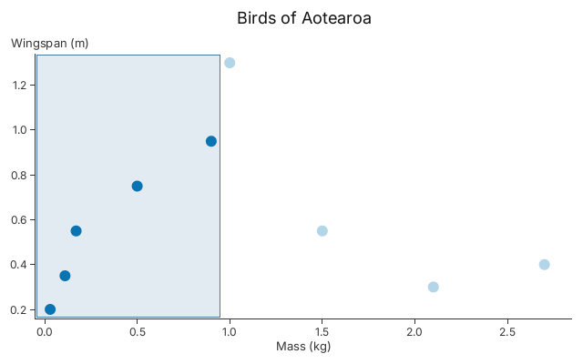

# Tutorial 4: Interactions

> **Goal**: hover a point for a tooltip, react to clicks, zoom and pan, brush a
> group of points, and test all of it without a window.
>
> Every code block on this page is compiled and run by `cargo test --doc`,
> except the one marked `no_run`, which opens a window and is only compiled. The
> image is a golden image checked by `tests/tutorials.rs`.

## What You Will Learn

- How a host turns events into `Input`, and what a chart answers
- How to show a tooltip and react to hover and click on rows
- How the wheel zooms and a drag pans, and how to limit that to one axis
- How a drag can zoom to a rectangle or brush the rows inside it
- How to find the row under a point by hand
- How to run a chart in a window, in egui or in Bevy

## Prerequisites

[Tutorial 2](02_data_binding.md): you know that a builder wraps a `Plot`, and
that a plot has layers of marks on shared scales.

## The Interaction Model

A chart has one entry point for interaction, `Chart::handle`. A host (the window
`gup::show` opens, `GupApp`, the egui and Bevy integrations, a web canvas) turns
its own events into `Input` values and passes them in:

| `Input`                      | Meaning                                  |
| ---------------------------- | ---------------------------------------- |
| `PointerMoved { at }`        | The pointer moved over the chart.        |
| `PointerLeft`                | The pointer left the chart.              |
| `PointerDown { at, button }` | A button went down.                      |
| `PointerUp { at, button }`   | A button went up.                        |
| `Wheel { at, lines }`        | The wheel turned (`lines > 0` zooms in). |

Positions are logical pixels from the chart's top-left corner (a plain `(x, y)`
pair of `f32`s works anywhere a position goes in), the same coordinates as the
chart's `Layout`. The chart answers with a `Response { redraw }`: when `redraw`
is true the chart looks different, so the host resolves and draws it again.

Because `handle` takes plain values, you can drive a chart yourself, without a
window. That is how every block below is tested: it resolves the chart at a
fixed size, works out where a mark is from the chart's layout, sends `Input`
values and checks what happened. Your own tests can do the same.

The data is a handful of New Zealand birds: each has a name, a mass in kilograms
(the x axis) and a wingspan in metres (the y axis).

## Step 1: Tooltips

`.tooltip(|row| text)` on a builder gives its marks a tooltip. The text is built
from the row, and `\n` starts a new line. To point at a mark, the block needs
its pixel position as `(x, y)`. The layout lists where its ticks are, and the
marks lie on the straight lines between them, so `pixel` interpolates:

```rust
use gup::prelude::*;
use gup::{Input, Layout, Response};

struct Bird {
    name: &'static str,
    mass: f64,
    span: f64,
}

/// Where the data point `(x, y)` is drawn, in the chart's pixels.
fn pixel(layout: &Layout, x: f64, y: f64) -> (f32, f32) {
    let along = |ticks: &[(f64, f32)], v: f64| {
        let (first, last) = (ticks[0], ticks[ticks.len() - 1]);
        first.1 + ((v - first.0) * f64::from(last.1 - first.1) / (last.0 - first.0)) as f32
    };
    (along(&layout.x_ticks, x), along(&layout.y_ticks, y))
}

fn main() -> gup::Result<()> {
    let birds = [("Tui", 0.11, 0.35), ("Kea", 0.90, 0.95), ("Takahe", 2.70, 0.40)]
        .map(|(name, mass, span)| Bird { name, mass, span });

    let mut chart = gup::scatter(birds)
        .x(|b| b.mass)
        .y(|b| b.span)
        .tooltip(|b| format!("{}\n{} kg, {} m", b.name, b.mass, b.span));

    let cx = Context::shared()?;
    chart.resolve(&cx, 640.0, 400.0)?;
    assert!(chart.layout().unwrap().tooltip.is_none());

    // Move the pointer onto the Kea.
    let kea = pixel(chart.layout().unwrap(), 0.90, 0.95);
    let response = chart.handle(Input::pointer_moved(kea));
    assert_eq!(response, Response { redraw: true });

    // The next resolve draws the tooltip beside the point.
    chart.resolve(&cx, 640.0, 400.0)?;
    assert!(chart.layout().unwrap().tooltip.is_some());

    // Moving off the point takes it away.
    let away = (kea.0 + 100.0, kea.1 + 100.0);
    assert!(chart.handle(Input::pointer_moved(away)).redraw);
    chart.resolve(&cx, 640.0, 400.0)?;
    assert!(chart.layout().unwrap().tooltip.is_none());
    Ok(())
}
```

`handle` did not draw anything. It recorded which row the pointer is over and
answered `redraw: true` because the tooltip changed; the tooltip itself is part
of the next `resolve`. A host does this on every event: `handle`, and if
`redraw`, `resolve` and present. (`Response` is `#[must_use]`.) A pointer move
that changes nothing, such as moving over empty space, answers `redraw: false`,
so a host that only redraws when asked stays idle.

## Step 2: Hover and Click on Rows

A tooltip is the common case. For everything else, `Plot::on_row` calls your
function for every `Enter`, `Leave` and `Click` on a row. The `EventInfo` it
receives says what happened, where, and to which row (a `RowId`). Get the row's
data back with `Plot::row::<T>(id)`.

A builder hands out its plot with `plot_mut()`. A click is a primary-button
press and release within a few pixels of each other, with the pointer over a
row:

```rust
use gup::prelude::*;
use gup::{Button, Event, Input, Layout, RowId};
use std::sync::{Arc, Mutex};

struct Bird {
    name: &'static str,
    mass: f64,
    span: f64,
}

fn pixel(layout: &Layout, x: f64, y: f64) -> (f32, f32) {
    let along = |ticks: &[(f64, f32)], v: f64| {
        let (first, last) = (ticks[0], ticks[ticks.len() - 1]);
        first.1 + ((v - first.0) * f64::from(last.1 - first.1) / (last.0 - first.0)) as f32
    };
    (along(&layout.x_ticks, x), along(&layout.y_ticks, y))
}

fn main() -> gup::Result<()> {
    let birds = [("Tui", 0.11, 0.35), ("Kea", 0.90, 0.95), ("Takahe", 2.70, 0.40)]
        .map(|(name, mass, span)| Bird { name, mass, span });
    let mut chart = gup::scatter(birds).x(|b| b.mass).y(|b| b.span);

    // The handler runs inside `handle`, so it only records what it saw.
    let seen: Arc<Mutex<Vec<(Event, RowId)>>> = Arc::default();
    let log = Arc::clone(&seen);
    chart
        .plot_mut()
        .on_row(move |info| log.lock().unwrap().push((info.event, info.row)));

    let cx = Context::shared()?;
    chart.resolve(&cx, 640.0, 400.0)?;
    let takahe = pixel(chart.layout().unwrap(), 2.70, 0.40);

    // Hover, press and release on the Takahe.
    let button = Button::Primary;
    let _ = chart.handle(Input::pointer_moved(takahe));
    let _ = chart.handle(Input::pointer_down(takahe, button));
    let _ = chart.handle(Input::pointer_up(takahe, button));

    let seen = seen.lock().unwrap();
    assert_eq!(
        seen.iter().map(|(event, _)| *event).collect::<Vec<_>>(),
        [Event::Enter, Event::Click]
    );

    // The row id says which row; the plot gives its data back.
    let (_, id) = seen[1];
    let bird = chart.plot_mut().row::<Bird>(id).unwrap();
    assert_eq!(bird.name, "Takahe");
    Ok(())
}
```

`Leave` follows when the pointer moves to another row, off the rows, out of the
chart (`Input::PointerLeft`), or when a zoom moves the row from under it. A drag
is not a click, and a drag that starts on a row leaves it.

`Selection::on(Event::Click, |info, row| ..)` is the same thing for one layer,
with the row's data passed in. `on_row` is for the whole plot, and it also runs
for layers that dropped their rows (`Retain::GpuOnly`).

## Step 3: Zoom, Pan and Reset

Nothing needs switching on: the wheel zooms about the pointer and a
primary-button drag pans, on both axes. Both only change the scales' domains, so
the next `resolve` is cheap: it writes a few uniforms and uploads no data. (They
do nothing until the first `resolve` has fitted the scales.)

`Plot::invert(at)` is the opposite of `pixel`: it gives the data values drawn at
a pixel. Here it shows the view move:

```rust
use gup::prelude::*;
use gup::{Button, Input, ScatterChart};

fn main() -> gup::Result<()> {
    let birds = [(0.11, 0.35), (0.90, 0.95), (1.50, 0.55), (2.70, 0.40)];
    let mut chart = gup::scatter(birds).x(|b| b.0).y(|b| b.1);

    let cx = Context::shared()?;
    let plot = chart.resolve(&cx, 640.0, 400.0)?.layout.plot;
    let middle = (plot.x + plot.width / 2.0, plot.y + plot.height / 2.0);

    // The width of the x domain, read at the plot's left and right edges.
    let width = |chart: &mut ScatterChart<(f64, f64)>| {
        let left = chart.plot_mut().invert((plot.left(), middle.1));
        let right = chart.plot_mut().invert((plot.right(), middle.1));
        right.unwrap().0 - left.unwrap().0
    };
    let full = width(&mut chart);

    // One turn of the wheel zooms in about the pointer.
    let response = chart.handle(Input::wheel(middle, 1.0));
    assert!(response.redraw);
    let zoomed = width(&mut chart);
    assert!(zoomed < full, "{zoomed} < {full}");

    // A drag pans: the values under the pointer follow it, so dragging right
    // shows what was further left.
    let before = chart.plot_mut().invert(middle).unwrap().0;
    let button = Button::Primary;
    let to = (middle.0 + 60.0, middle.1);
    let _ = chart.handle(Input::pointer_down(middle, button));
    let _ = chart.handle(Input::pointer_moved(to));
    let _ = chart.handle(Input::pointer_up(to, button));
    assert!(chart.plot_mut().invert(middle).unwrap().0 < before);
    assert!((width(&mut chart) - zoomed).abs() < 1e-9); // panning keeps the zoom

    // Back to the fitted view.
    chart.plot_mut().reset_view();
    chart.resolve(&cx, 640.0, 400.0)?;
    assert!((width(&mut chart) - full).abs() < 1e-9);
    Ok(())
}
```

`Plot::zoom(at, factor)` and `Plot::pan(dx, dy)` do the same without `Input`,
for a "zoom in" button; they move both axes. To let input move only one axis, as
you want for a time series, use `view_axes(Axes::X)` (`Axes::Y` and
`Axes::Neither` are the others):

```rust
use gup::prelude::*;
use gup::Input;

fn main() -> gup::Result<()> {
    let readings = [(1.0, 5.0), (2.0, 7.0), (3.0, 4.0), (4.0, 8.0)];
    let mut chart = gup::line(readings).x(|r| r.0).y(|r| r.1);
    chart.plot_mut().view_axes(Axes::X);

    let cx = Context::shared()?;
    let plot = chart.resolve(&cx, 640.0, 400.0)?.layout.plot;
    let middle = (plot.x + plot.width / 2.0, plot.y + plot.height / 2.0);

    // The values at the top of the plot, before and after a wheel turn.
    let top = (plot.left(), plot.top());
    let (x0, y0) = chart.plot_mut().invert(top).unwrap();
    let _ = chart.handle(Input::wheel(middle, 2.0));
    let (x1, y1) = chart.plot_mut().invert(top).unwrap();

    assert_ne!(x0, x1); // x zoomed
    assert_eq!(y0, y1); // y did not
    Ok(())
}
```

A band or point axis (the categories of a bar chart) is never moved by input.

## Step 4: A Drag That Zooms

`Plot::drag` chooses what a primary-button drag does: `Drag::Pan` (the default),
`Drag::Off`, `Drag::Zoom` and `Drag::Brush`. With `Drag::Zoom`, the drag draws a
rectangle, and on release the view becomes that rectangle:

```rust
use gup::prelude::*;
use gup::{Button, Input};

fn main() -> gup::Result<()> {
    let points = [(0.0, 0.0), (1.0, 3.0), (2.0, 1.0), (3.0, 4.0), (4.0, 2.0)];
    let mut chart = gup::scatter(points).x(|p| p.0).y(|p| p.1);
    chart.plot_mut().drag(Drag::Zoom);

    let cx = Context::shared()?;
    let plot = chart.resolve(&cx, 640.0, 400.0)?.layout.plot;

    // Drag a rectangle over the middle of the plot, and note its corners in
    // data units.
    let from = (plot.x + plot.width * 0.25, plot.y + plot.height * 0.25);
    let to = (plot.x + plot.width * 0.75, plot.y + plot.height * 0.75);
    let corner = chart.plot_mut().invert(from).unwrap();

    let button = Button::Primary;
    let _ = chart.handle(Input::pointer_down(from, button));
    let _ = chart.handle(Input::pointer_moved(to));
    let response = chart.handle(Input::pointer_up(to, button));
    assert!(response.redraw);

    // The rectangle's top-left corner is now the plot's.
    let top_left = (plot.left(), plot.top());
    let (x, y) = chart.plot_mut().invert(top_left).unwrap();
    assert!((x - corner.0).abs() < 1e-6, "{x} {}", corner.0);
    assert!((y - corner.1).abs() < 1e-6, "{y} {}", corner.1);
    Ok(())
}
```

## Step 5: Brushing

With `Drag::Brush`, dragging selects. The rows whose marks lie inside the
dragged rectangle become the plot's `brush()`, and while a brush exists the
theme's `Unbrushed` setting draws every other row dimmed (`Unbrushed::Fade(0.3)`
by default; `Unbrushed::Grey(color)` is the other choice, set through
`Theme { unbrushed, .. }`). A click clears the brush.

A `Brush` holds the rectangle in data units and the selected `RowId`s. Register
`on_brush` to hear about a brush as soon as the button goes up; it is called
with `None` when the brush is cleared:

```rust
use gup::prelude::*;
use gup::{Button, Input};
use std::sync::{Arc, Mutex};

struct Bird {
    name: &'static str,
    mass: f64,
    span: f64,
}

fn main() -> gup::Result<()> {
    let birds = [
        ("Bellbird", 0.03, 0.20),
        ("Tui", 0.11, 0.35),
        ("Morepork", 0.17, 0.55),
        ("Kaka", 0.50, 0.75),
        ("Kea", 0.90, 0.95),
        ("Harrier", 1.00, 1.30),
        ("Pukeko", 1.50, 0.55),
        ("Weka", 2.10, 0.30),
        ("Takahe", 2.70, 0.40),
    ]
    .map(|(name, mass, span)| Bird { name, mass, span });

    let mut chart = gup::scatter(birds)
        .x(|b| b.mass)
        .y(|b| b.span)
        .radius(6.0)
        .title("Birds of Aotearoa")
        .x_title("Mass (kg)")
        .y_title("Wingspan (m)");
    chart.plot_mut().drag(Drag::Brush);

    // Count what `on_brush` is told.
    let heard: Arc<Mutex<Vec<Option<usize>>>> = Arc::default();
    let log = Arc::clone(&heard);
    chart
        .plot_mut()
        .on_brush(move |brush| log.lock().unwrap().push(brush.map(|b| b.rows.len())));

    let cx = Context::shared()?;
    let plot = chart.resolve(&cx, 640.0, 400.0)?.layout.plot;
    let ticks = chart.layout().unwrap().x_ticks.clone();

    // Drag from the bottom-left corner to the right of the Kea and the top
    // of the plot: five birds are inside.
    let (first, last) = (ticks[0], ticks[ticks.len() - 1]);
    let kea_x = first.1 + ((0.95 - first.0) * f64::from(last.1 - first.1) / (last.0 - first.0)) as f32;
    let from = (plot.left() + 1.0, plot.bottom() - 1.0);
    let to = (kea_x, plot.top() + 1.0);
    let button = Button::Primary;
    let _ = chart.handle(Input::pointer_down(from, button));
    let _ = chart.handle(Input::pointer_moved(to));
    let _ = chart.handle(Input::pointer_up(to, button));

    let rows = chart.plot_mut().brush().expect("a brush").rows.clone();
    let mut names: Vec<_> = rows
        .iter()
        .map(|&id| chart.plot_mut().row::<Bird>(id).unwrap().name)
        .collect();
    names.sort_unstable();
    assert_eq!(names, ["Bellbird", "Kaka", "Kea", "Morepork", "Tui"]);
    assert_eq!(*heard.lock().unwrap(), [Some(5)]);

    // `clear_brush` (or a click) removes it and tells the handler.
    chart.plot_mut().clear_brush();
    assert!(chart.plot_mut().brush().is_none());
    assert_eq!(heard.lock().unwrap().last(), Some(&None));
    Ok(())
}
```

A row is brushed when its mark's position is inside the rectangle (a disc's
centre, a segment's midpoint, a line's vertex), edges included. A large mark
that merely overlaps the rectangle is not brushed. Here is that chart with the
brush in place:



To drive something else from a brush, such as a table of the selected rows, read
the `Brush` in `on_brush`. The callback runs inside `handle`, so send what you
need to your own state and draw from there.

## Step 6: Finding a Row by Hand

Everything above finds the row under the pointer for you. When you have a pixel
and want the row, ask the chart. `pick_row(at)` answers with a `RowId`, and
`pick::<T>(at)` on a plot (or `pick(at)` on a builder) with the data:

```rust
use gup::prelude::*;
use gup::Layout;

struct Bird {
    name: &'static str,
    mass: f64,
    span: f64,
}

fn pixel(layout: &Layout, x: f64, y: f64) -> (f32, f32) {
    let along = |ticks: &[(f64, f32)], v: f64| {
        let (first, last) = (ticks[0], ticks[ticks.len() - 1]);
        first.1 + ((v - first.0) * f64::from(last.1 - first.1) / (last.0 - first.0)) as f32
    };
    (along(&layout.x_ticks, x), along(&layout.y_ticks, y))
}

fn main() -> gup::Result<()> {
    let birds = [("Tui", 0.11, 0.35), ("Kea", 0.90, 0.95), ("Takahe", 2.70, 0.40)]
        .map(|(name, mass, span)| Bird { name, mass, span });
    let mut chart = gup::scatter(birds).x(|b| b.mass).y(|b| b.span);

    let cx = Context::shared()?;
    chart.resolve(&cx, 640.0, 400.0)?;
    let kea = pixel(chart.layout().unwrap(), 0.90, 0.95);

    assert_eq!(chart.pick(kea).map(|b| b.name), Some("Kea"));
    assert!(chart.plot_mut().pick_row(kea).is_some());

    // Empty space, and anywhere outside the plot area, picks nothing.
    assert!(chart.plot_mut().pick_row((kea.0 + 60.0, kea.1 + 60.0)).is_none());
    assert!(chart.plot_mut().pick_row((2.0, 2.0)).is_none());
    Ok(())
}
```

The pick runs on the CPU over the rows the layer kept, in the same pixels the
marks were drawn at. It finds the topmost mark under the point, else the nearest
within a few pixels.

## Hosts

Passing events to `handle` is the host's job, and you rarely write one.

- **A window.** `gup::show(chart)` opens one, passes the pointer and the wheel
  to `handle`, redraws when asked, and returns when the window closes. `GupApp`
  adds a window title and size.
- **egui.** `gup-egui` shows any chart in an egui panel and forwards the input.
  See the [egui integration guide](../EGUI_INTEGRATION.md).
- **Bevy.** `gup-bevy` does the same for a Bevy app. See the
  [Bevy integration guide](../BEVY_INTEGRATION.md).
- **The web.** `web::CanvasApp` runs a chart on a canvas in the browser;
  `mask wasm-browser` builds and tries it.

```rust,no_run
use gup::prelude::*;
use gup::GupApp;

fn main() -> gup::Result<()> {
    let mut chart = gup::scatter([(0.11, 0.35), (0.90, 0.95), (2.70, 0.40)])
        .x(|b| b.0)
        .y(|b| b.1)
        .tooltip(|b| format!("{} kg, {} m", b.0, b.1));
    chart.plot_mut().drag(Drag::Brush);

    GupApp::new(chart).title("Birds").size(900, 600).run()
}
```

Run it and try it by hand: hover, wheel and drag. A window cannot run in CI, but
the blocks above test the same code path, because a window feeds `Chart::handle`
the same `Input` values. `gup::show(chart)` is `GupApp::new(chart).run()`.

## Where Next

- [Tutorial 5: Streaming Data](05_streaming_data.md) feeds a chart rows from
  another thread.
- [Tutorial 6: Custom Marks](06_custom_marks.md) writes a mark of your own; it
  hovers and picks like the built-in ones.
