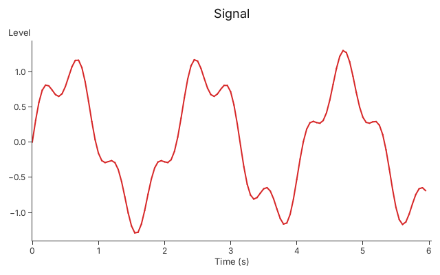

# Tutorial 5: Streaming Data

> **Goal**: feed a chart rows as they arrive, from another thread, and keep its
> memory bounded however long it runs.
>
> Every code block on this page is compiled and run by `cargo test --doc`,
> except the one marked `no_run`, which opens a window and is only compiled. The
> image is a golden image checked by `tests/tutorials.rs`.

## What You Will Learn

- How to get an `Appender` from a chart and push rows into it from any thread
- When pushed rows are drawn
- How `Window::LastRows(n)` bounds the rows a layer holds
- What `Retain` does for a very large layer
- How a line chart gains a line for each new key
- What happens to an appender when its chart goes away

## Prerequisites

[Tutorial 1](01_getting_started.md): you can draw a chart from your own structs.
You do not need an async runtime: streaming here is plain `std::thread`.

## Step 1: An Appender

A chart built from a collection has its rows from the start. To add more later,
ask the builder for an `Appender`. It is a cheap, cloneable handle that you can
move to any thread, and it works while the chart is shown or rendered.

`push(row)` queues one row. `extend(rows)` queues a batch: one wake-up and one
upload however many rows it holds, so prefer it when a source delivers rows in
bursts.

```rust
use gup::prelude::*;

fn main() -> gup::Result<()> {
    let mut chart = gup::scatter([(0.0, 0.0)]).x(|p| p.0).y(|p| p.1);
    let feed = chart.appender();

    // Another thread produces rows.
    let producer = std::thread::spawn(move || {
        for i in 1..=50 {
            let x = f64::from(i);
            feed.push((x, x.sqrt())).unwrap();
        }
        feed.extend((51..=100).map(|i| (f64::from(i), 10.0))).unwrap();
    });
    producer.join().unwrap();

    // Pushed rows wait in a queue. They reach the chart, and the screen, at
    // the next resolve.
    assert_eq!(chart.layer_mut().len(), 1);
    let cx = Context::shared()?;
    chart.resolve(&cx, 640.0, 400.0)?;
    assert_eq!(chart.layer_mut().len(), 101);
    Ok(())
}
```

"Drawn by the next resolve" is the whole contract. Between two frames you may
push any number of rows from any number of threads. The next `resolve` takes
them all and evaluates and uploads only the new rows (not the old ones again),
then redraws the automatic scales to include them. It does this whether the
frame is for a window, a PNG or a test. A window host (`gup::show`, `GupApp`,
the egui and Bevy integrations) is woken when rows arrive, so a chart that
nothing else touches still updates. The thread that pushes never waits for the
GPU. In the block above, the thread is joined before the length is read, which
is all a test needs: no sleeps.

The same handle is available one level down. A `Plot` layer is a `Selection`,
and `Selection::appender()` gives one the same way, for any mark:

```rust
use gup::prelude::*;

fn main() -> gup::Result<()> {
    let mut plot = Plot::new();
    plot.line(vec![(0.0, 0.0)]).x(|p| p.0).y(|p| p.1);

    let feed = plot.layer_mut::<(f64, f64), Line>().unwrap().appender();
    feed.extend((1..=20).map(|i| (f64::from(i), f64::from(i * i)))).unwrap();

    let cx = Context::shared()?;
    plot.resolve(&cx, 640.0, 400.0)?;
    assert_eq!(plot.layer_mut::<(f64, f64), Line>().unwrap().len(), 21);
    Ok(())
}
```

Rows can also be added without a thread, on the same thread that owns the plot,
with `Selection::append(rows)`. Reach for an `Appender` when the producer is
somewhere else.

## Step 2: A Line That Grows

Here is a line that a thread feeds, drawn after three batches have arrived. The
chart's axes refit to the rows each time:

```rust
use gup::prelude::*;

fn main() -> gup::Result<()> {
    let mut chart = gup::line([(0.0, 0.0)])
        .x(|p| p.0)
        .y(|p| p.1)
        .stroke(Color::hex(0xd62728))
        .width(2.0)
        .title("Signal")
        .x_title("Time (s)")
        .y_title("Level");
    let feed = chart.appender();

    std::thread::spawn(move || {
        for batch in 0..3 {
            let rows = (0..40).map(|i| {
                let t = f64::from(batch * 40 + i) * 0.05;
                (t, (t * 3.0).sin() + 0.3 * (t * 11.0).sin())
            });
            feed.extend(rows).unwrap();
        }
    })
    .join()
    .unwrap();

    let cx = Context::shared()?;
    chart.resolve(&cx, 640.0, 400.0)?;
    let image = chart.render(&cx, 640, 400)?;
    assert_eq!(image.dimensions(), (640, 400));
    Ok(())
}
```



For a window, run the producer in a thread and hand the chart to `gup::show`.
The window redraws as rows arrive:

```rust,no_run
use gup::prelude::*;
use std::time::Duration;

fn main() -> gup::Result<()> {
    let mut chart = gup::line([(0.0, 0.0)])
        .x(|p| p.0)
        .y(|p| p.1)
        .window(Window::LastRows(2_000));
    let feed = chart.appender();

    std::thread::spawn(move || {
        for i in 1.. {
            std::thread::sleep(Duration::from_millis(20));
            let t = f64::from(i) * 0.02;
            // `Err` means the window closed: stop.
            if feed.push((t, (t * 4.0).sin())).is_err() {
                break;
            }
        }
    });

    gup::show(chart)
}
```

## Step 3: Bounding Memory With a Window

A chart that runs for days cannot keep every row. `window(Window::LastRows(n))`
keeps the newest `n` rows and lets older ones go. `Window::All` is the default.

Rows leave a whole chunk at a time (a chunk is the unit of the GPU buffers), so
a layer holds between `n` and about `1.25 × n` rows, not exactly `n`. That is
what makes eviction cheap: it moves no data. Set the window before the first
resolve, because changing it changes the chunk size.

```rust
use gup::prelude::*;

fn main() -> gup::Result<()> {
    let cx = Context::shared()?;
    let mut chart = gup::line(Vec::<(f64, f64)>::new())
        .x(|p| p.0)
        .y(|p| p.1)
        .window(Window::LastRows(8_000));
    let feed = chart.appender();

    for batch in 0..10 {
        feed.extend((0..2_000).map(|i| (f64::from(batch * 2_000 + i), 0.0)))
            .unwrap();
        chart.resolve(&cx, 640.0, 400.0)?;
        let held = chart.layers_mut()[0].len();
        // 2,000 more rows each time, yet the layer stays near 8,000.
        assert!(held < 10_000, "{held}");
    }

    let held = chart.layers_mut()[0].len();
    assert!((8_000..10_000).contains(&held), "{held}");
    Ok(())
}
```

A window is per layer. It applies to scatter and line charts alike, and to any
layer through `Selection::window`.

## Step 4: Retain, for Large Layers

Rows kept for a chart cost twice: once on the GPU, and once on the CPU for
hover, tooltips and re-encoding (see Tutorial 2, "What a Layer Keeps"). For a
layer of millions of rows that fed in once, say that you do not need the CPU
copy:

```rust
use gup::prelude::*;

fn main() -> gup::Result<()> {
    let mut chart = gup::scatter(Vec::<(f64, f64)>::new())
        .x(|p| p.0)
        .y(|p| p.1);
    chart.layer_mut().retain(Retain::GpuOnly);
    let feed = chart.appender();
    feed.extend((0..5_000).map(|i| (f64::from(i), f64::from(i % 97)))).unwrap();

    let cx = Context::shared()?;
    chart.resolve(&cx, 640.0, 400.0)?;
    assert_eq!(chart.layer_mut().len(), 5_000);
    Ok(())
}
```

Appending works under every policy: the newest chunk keeps its CPU copy so rows
can still be added, and appended rows are released after upload like the rest.
What you lose under `GpuOnly` is what needs the rows: tooltips, `on_row`
handlers, `pick::<T>`, vector output, and rendering on a second device.
`Retain::Auto` is already `GpuOnly` above 10 million rows. Combine it with a
window when the stream never ends.

## Step 5: Keyed Lines

A line chart coloured by key draws a line for each key, and a key the chart has
not seen before adds a line, with the next colour and a legend entry. This is
how a dashboard shows sensors that come online while it runs. The appender of a
keyed chart routes each row to its key's line:

```rust
use gup::prelude::*;

struct Reading {
    sensor: String,
    t: f64,
    value: f64,
}

fn main() -> gup::Result<()> {
    let reading = |sensor: &str, t: f64| Reading {
        sensor: sensor.to_string(),
        t,
        value: t * t,
    };
    let mut chart = gup::line([reading("north", 0.0), reading("south", 0.0)])
        .x(|r| r.t)
        .y(|r| r.value)
        .color(|r| r.sensor.clone());
    let feed = chart.appender();

    let cx = Context::shared()?;
    chart.resolve(&cx, 640.0, 400.0)?;
    assert_eq!(chart.layers_mut().len(), 2);

    // A third sensor comes online.
    feed.extend((0..5).map(|i| reading("east", f64::from(i)))).unwrap();
    feed.push(reading("north", 1.0)).unwrap();
    chart.resolve(&cx, 640.0, 400.0)?;
    assert_eq!(chart.layers_mut().len(), 3);
    assert_eq!(chart.layers_mut()[0].len(), 2); // north: 0, then 1
    assert_eq!(chart.layers_mut()[2].len(), 5); // east
    Ok(())
}
```

Lines are in the order their keys first appeared. A window on a keyed chart
applies to every line: each keeps its own newest `n` rows.

## Step 6: When the Chart Is Gone

An appender does not keep its chart alive. Once the chart is dropped, `push` and
`extend` return `Err(Closed)`. A producer thread treats that as its signal to
stop, which is how the window example above ends its thread:

```rust
use gup::prelude::*;
use gup::Closed;

fn main() {
    let mut chart = gup::scatter([(0.0, 0.0)]).x(|p| p.0).y(|p| p.1);
    let feed = chart.appender();
    assert_eq!(feed.push((1.0, 1.0)), Ok(()));

    drop(chart);
    assert_eq!(feed.push((2.0, 2.0)), Err(Closed));
    assert_eq!(feed.extend([(3.0, 3.0)]), Err(Closed));
}
```

`Closed` implements `std::error::Error`, so `?` works in a producer that returns
a `Result`. Pushing an empty batch is always `Ok`.

## Where Next

- [Tutorial 4: Interactions](04_interactions.md) makes a live chart something
  you can hover and zoom.
- [Tutorial 6: Custom Marks](06_custom_marks.md) writes a mark of your own.
- The [Performance Guide](../PERFORMANCE_GUIDE.md) has tips for large data.
