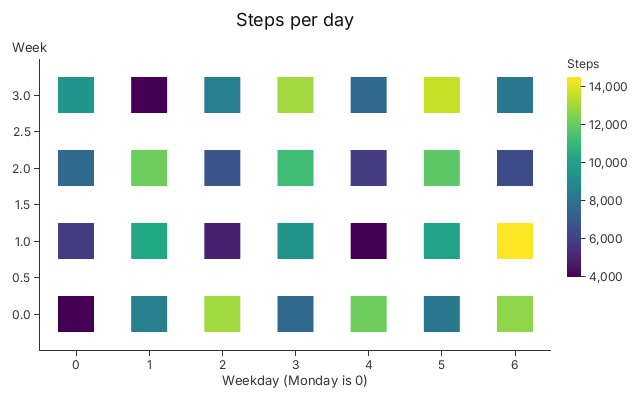

# Tutorial 6: Custom Marks

> **Goal**: draw a shape Gup does not have, as a first-class mark: it takes its
> position from the plot's axes, gets legends, can be hovered, and is drawn by
> the same single GPU pass as a circle.
>
> Every code block on this page is compiled and run by `cargo test --doc`,
> except the one marked `compile_fail`, which is checked to be rejected. Every
> image is a golden image checked by `tests/tutorials.rs`. The reference for
> every `#[mark(..)]` and `#[channel(..)]` key is on the
> [`Mark`](https://docs.rs/gup-core/latest/gup_core/trait.Mark.html) trait.

## What You Will Learn

- What a mark is: a struct of channels and a WGSL module with a fixed contract
- How to write a `Square` mark with `#[derive(Mark)]` and draw it in a `Plot`
- What each channel role (`X`, `Y`, `Size`, `Width`, `Height`, `Color`) does
- How the generated setters work
- How to make a mark pickable, on the CPU and on the GPU
- What `geometry = Polyline` and `antialias = Msaa` are for
- What the compiler tells you when the struct and the WGSL disagree

## Prerequisites

Tutorials 2 and 3: you can build a `Plot`, encode channels through scales, and
write a WGSL function.

## What a Mark Is

`Circle`, `Rect`, `Segment` and `Line` are marks that ship with Gup. None of
them is special: each is a Rust struct plus a WGSL module, and you can write
another the same way. The two halves say different things:

- **The struct** lists the mark's **channels**: the properties a row of data can
  drive, such as `x`, `y`, `size` and `fill`. Each has a type (`Px` for a length
  in pixels, `Color` for a colour, `Unit` for a number from 0 to 1), a **role**
  that says how the plot treats it, and optionally a default. The struct is
  never built; its fields are a declaration.
- **The WGSL module** says how the mark is drawn, by following a small
  **contract**:
  1. A struct named `<Name>In` (for a mark called `Square`, `SquareIn`) with one
     field per channel, in the same order and with the matching WGSL type (`f32`
     for `Px` and `Unit`, `vec4<f32>` for `Color`). For each instance (one per
     row), Gup fills it in from the row's encoded values.
  2. A struct named `Varyings`, whatever you want to pass from the vertex stage
     to the fragment stage. One member must be the position, declared
     `@builtin(position) clip: vec4<f32>`, and it must be called `clip`. Gup
     moves it off-screen to hide a row whose value is missing.
  3. `fn vertex(m: SquareIn, vertex_index: u32, row: u32, view: View) -> Varyings`,
     called six times per row (two triangles make a quad) with `vertex_index` 0
     to 5. It places each corner of the quad in _logical pixels_, which
     `px_to_clip` turns into clip space. `row` is the row's index, and `view`
     says the plot's size and the display's pixel ratio.
  4. `fn shade(v: Varyings) -> vec4<f32>`, called for each pixel the quad
     covers. It returns the colour **premultiplied**: red, green and blue
     already multiplied by alpha. It may `discard` a pixel.

The reason the vertex stage works in logical pixels is that a mark's size is
usually in pixels (a circle is 6 px across at any zoom), while its position is
in data. By the time `vertex` runs, Gup has already turned the position channels
into pixels through the plot's scales, so your WGSL never sees data units, a
domain or a zoom.

## Step 1: A Square

A square, `size` pixels across, centred on `(x, y)`. The edges need to be
smooth, so the shader does not draw a plain quad: it asks `gup::coverage` for
the quad and for how much of each pixel the box covers, which is the same
anti-aliasing the library's rectangles use.

```rust
use gup::prelude::*;

/// A filled square centred on `(x, y)`, `size` logical pixels across.
#[derive(Debug, Mark)]
#[mark(
    path = "tutorial6_square",
    wgsl = r#"
    #import gup::view::{View, px_to_clip}
    #import gup::coverage::{rect_quad, box_coverage}

    struct SquareIn {
        x: f32,
        y: f32,
        size: f32,
        fill: vec4<f32>,
    }

    struct Varyings {
        @builtin(position) clip: vec4<f32>,
        @location(0) local: vec2<f32>,
        @location(1) half: vec2<f32>,
        @location(2) fill: vec4<f32>,
    }

    fn vertex(m: SquareIn, vertex_index: u32, row: u32, view: View) -> Varyings {
        let centre = vec2<f32>(m.x, m.y);
        let half = vec2<f32>(m.size * 0.5);
        let q = rect_quad(centre - half, centre + half, vertex_index, view.dpr);
        var out: Varyings;
        out.clip = px_to_clip(q.position, view);
        out.local = q.local;
        out.half = q.half;
        out.fill = m.fill;
        return out;
    }

    fn shade(v: Varyings) -> vec4<f32> {
        let alpha = v.fill.a * box_coverage(v.local, v.half);
        if (alpha <= 0.0) {
            discard;
        }
        return vec4<f32>(v.fill.rgb * alpha, alpha);
    }
"#,
    geometry = Quad
)]
struct Square {
    #[channel(role = X)]
    x: Px,
    #[channel(role = Y)]
    y: Px,
    #[channel(role = Size, default = Px(10.0))]
    size: Px,
    #[channel(role = Color, default = Color::BLACK)]
    fill: Color,
}

struct Day {
    week: f64,
    weekday: f64,
    steps: f64,
}

fn main() -> gup::Result<()> {
    // Four weeks of step counts, a little different each day.
    let days: Vec<Day> = (0..28)
        .map(|i| {
            let (week, weekday) = (f64::from(i / 7), f64::from(i % 7));
            let steps = 4000.0 + 900.0 * ((i * 5) % 11) as f64 + 1500.0 * f64::from(weekday > 4.5);
            Day { week, weekday, steps }
        })
        .collect();

    let mut plot = Plot::new();
    plot.title("Steps per day")
        .x_title("Weekday (Monday is 0)")
        .y_title("Week");
    let steps = Sequential::viridis();
    plot.add(Selection::<Day, Square>::new(days))
        .x(|d| d.weekday)
        .y(|d| d.week)
        .size(Px(36.0))
        .fill(steps.encode(|d: &Day| d.steps))
        .legend_title(Square::FILL, "Steps");

    let image = plot.render(&Context::shared()?, 640, 400)?;
    assert_eq!(image.dimensions(), (640, 400));

    // What the derive made of the struct.
    assert_eq!(Square::NAME, "Square");
    let names: Vec<_> = Square::CHANNELS.iter().map(|c| c.name).collect();
    assert_eq!(names, ["x", "y", "size", "fill"]);
    Ok(())
}
```



Four things happened in that block.

**The derive read the struct.** `#[derive(Mark)]` made `Square` a `Mark`: it
built the channel list (`Square::CHANNELS`) from the fields in order, and it
checks them against `SquareIn` in your WGSL when your crate compiles (Step 5).
It also gave you the channel constants, `Square::X`, `Square::SIZE`,
`Square::FILL` and so on, which `Selection::attr` takes.

**`path = "tutorial6_square"`** names the WGSL module, which is how a shader
function or another mark could `#import` yours. The default is your crate's name
and the struct's name in snake case (`my_crate::square`), which is what you want
in a real project. A documentation test's crate is named after `gup`, and the
`gup::` namespace belongs to the library, so a doctest must choose its own.

**The setters are generated, too.** The derive adds a trait, `SquareAttrs`, with
one method per channel, implemented for `Selection<T, Square>`, and brings it in
scope where the struct is defined. A channel with an `X` or `Y` role gets two
setters: `.x(|d| d.weekday)`, a closure that Gup encodes through the plot's x
scale when the plot resolves, and `.x_with(encoding)` for a constant or a scale
you made yourself (`.x_with(log_x.encode(|d| d.weekday))`). Every other channel
takes a constant or an encoding: `.size(Px(36.0))` is a constant, and
`.fill(steps.encode(|d: &Day| d.steps))` colours each square through a viridis
scale. Because the setters are typed by the channel, `.size(steps.encode(..))`
does not compile, as in Tutorial 2.

**A channel not set uses its default.** `size` defaults to `Px(10.0)` and `fill`
to black, from `default = ..` in the struct. A channel with no default is zero.
The block overrode both, so the defaults were not used, but a plain
`plot.add(Selection::<Day, Square>::new(days)).x(..).y(..)` already draws.

## Step 2: What the Roles Do

The `role` is how a channel meets the plot. A channel with no `role` (like
`fill_opacity` on `Circle`) is just a number or colour for your shader. A role
tells the plot what to do with the channel:

| Role     | The channel is                  | What the plot does                                                                                                                                                     |
| -------- | ------------------------------- | ---------------------------------------------------------------------------------------------------------------------------------------------------------------------- |
| `X`      | a horizontal position           | Joins the x scale: `.x(closure)` encodes through it, the automatic domain is fitted to its data, and axis ticks are placed in its range.                               |
| `Y`      | a vertical position             | The same for the y scale.                                                                                                                                              |
| `Size`   | a mark size in pixels           | Leaves room: the plot grows its automatic domain so the largest size you draw is not clipped at the plot's edge. A size from a scale counts its range's largest value. |
| `Width`  | a full extent along x in pixels | Leaves room on x: half of it, past each position, as overhang. A column-encoded width is not counted.                                                                  |
| `Height` | a full extent along y in pixels | The same on y.                                                                                                                                                         |
| `Color`  | a colour                        | Colour scales encoded here give the plot a legend (`.legend_title(Square::FILL, "Steps")` titles it).                                                                  |

Two consequences follow from that list. Only an `X` or `Y` channel can take a
plain closure (`.x(|d| d.weekday)`), because only a position has a plot scale
for the closure's number to go through; every other channel takes a constant or
an encoding through a scale you chose, such as `.size(Px(36.0))`. And you give
`Size`, `Width` or `Height` to the channels that are extents so that the plot
leaves room for them: a `Square` of `size: Px(36.0)` centred at the largest x
would be half off the plot without it, which is why the squares in the picture
are whole at every edge.

## Step 3: Make It Pickable

A mark is not hoverable until you say how a pointer hits it. Gup picks on the
CPU (a spatial index of each mark's shape, which feeds tooltips and `plot.pick`)
and on the GPU (the mark is drawn into a small pick target and the row it reads
back is the answer). You opt into each in the `#[mark(..)]` attribute:

- **`hit = AlignedBox`** gives the mark a CPU shape: an axis-aligned box. The
  other shapes are `Disc`, `Segment` and `Polyline`. Each shape reads particular
  channels by name, and the derive checks that your struct has them, as `Px`.
  `AlignedBox` reads `x`, `y`, `width`, `height`, `x_end` and `y_end`, the
  channels `Rect` has: on each axis, a non-zero extent (`width`, `height`) is a
  box centred on `x` (`y`), and a zero one is the span between `x` and `x_end`
  (`y` and `y_end`). A `Square` with one `size` has none of these names, so here
  is a `Tile`, which is a `Rect` with only a fill.
- **`gpu_pick`** says the module draws itself in a pick pass. Then it must
  define `fn hit_distance(v: Varyings) -> f32`, how far in physical pixels the
  fragment is from the mark, negative inside, and
  `fn hit_row(v: Varyings) -> u32`, the row it reports. `Varyings` must carry
  the row, and the vertex stage must grow the quad by `view.pick_margin`, so
  that a pointer just outside a mark's edge still finds it. The derive checks
  that both functions exist.

```rust
use gup::geom::Point;
use gup::prelude::*;

/// A filled box, from the centre and size, or from two edges.
#[derive(Debug, Mark)]
#[mark(
    path = "tutorial6_tile",
    wgsl = r#"
    #import gup::view::{View, px_to_clip}
    #import gup::coverage::{rect_quad, grow_quad, box_coverage, box_distance}

    struct TileIn {
        x: f32,
        y: f32,
        width: f32,
        height: f32,
        x_end: f32,
        y_end: f32,
        fill: vec4<f32>,
    }

    struct Varyings {
        @builtin(position) clip: vec4<f32>,
        @location(0) local: vec2<f32>,
        @location(1) half: vec2<f32>,
        @location(2) fill: vec4<f32>,
        @location(3) @interpolate(flat) row: u32,
    }

    // The span lo..hi on one axis: centred with an extent, else between edges.
    fn span(centre: f32, extent: f32, edge: f32) -> vec2<f32> {
        if (extent != 0.0) {
            let h = abs(extent) * 0.5;
            return vec2<f32>(centre - h, centre + h);
        }
        return vec2<f32>(min(centre, edge), max(centre, edge));
    }

    fn vertex(m: TileIn, vertex_index: u32, row: u32, view: View) -> Varyings {
        let sx = span(m.x, m.width, m.x_end);
        let sy = span(m.y, m.height, m.y_end);
        let q = grow_quad(
            rect_quad(vec2<f32>(sx.x, sy.x), vec2<f32>(sx.y, sy.y), vertex_index, view.dpr),
            view.pick_margin,
            vertex_index,
            view.dpr,
        );
        var out: Varyings;
        out.clip = px_to_clip(q.position, view);
        out.local = q.local;
        out.half = q.half;
        out.fill = m.fill;
        out.row = row;
        return out;
    }

    fn shade(v: Varyings) -> vec4<f32> {
        let alpha = v.fill.a * box_coverage(v.local, v.half);
        if (alpha <= 0.0) {
            discard;
        }
        return vec4<f32>(v.fill.rgb * alpha, alpha);
    }

    fn hit_distance(v: Varyings) -> f32 {
        return box_distance(v.local, v.half);
    }

    fn hit_row(v: Varyings) -> u32 {
        return v.row;
    }
"#,
    geometry = Quad,
    hit = AlignedBox,
    gpu_pick
)]
struct Tile {
    #[channel(role = X)]
    x: Px,
    #[channel(role = Y)]
    y: Px,
    #[channel(role = Width, default = Px(24.0))]
    width: Px,
    #[channel(role = Height, default = Px(24.0))]
    height: Px,
    #[channel(role = X)]
    x_end: Px,
    #[channel(role = Y)]
    y_end: Px,
    #[channel(role = Color, default = Color::hex(0x0072b2))]
    fill: Color,
}

struct Seat {
    name: &'static str,
    col: f64,
    row: f64,
}

fn main() -> gup::Result<()> {
    let seats = vec![
        Seat { name: "A1", col: 1.0, row: 1.0 },
        Seat { name: "A2", col: 2.0, row: 1.0 },
        Seat { name: "B1", col: 1.0, row: 2.0 },
        Seat { name: "B2", col: 2.0, row: 2.0 },
    ];

    let cx = Context::shared()?;
    let mut plot = Plot::new();
    let (x, y) = (plot.x(Linear::new()), plot.y(Linear::new()));
    plot.add(Selection::<Seat, Tile>::new(seats))
        .x(|s| s.col)
        .y(|s| s.row);
    plot.resolve(&cx, 320.0, 200.0)?;

    // The middle of seat B1, in logical pixels, from the plot's own scales.
    let b1 = Point::new(x.read().eval(1.0) as f32, y.read().eval(2.0) as f32);

    // On the CPU, the data of the row under a point.
    assert_eq!(plot.pick::<Seat>(b1).map(|s| s.name), Some("B1"));
    // On the GPU, the row's id; the same answer.
    let row = plot.pick_row_gpu(&cx, b1)?.expect("a seat is drawn there");
    assert_eq!(row, plot.pick_row(b1).expect("and on the CPU"));
    assert_eq!(row.row, 2);

    // Between the seats, nothing.
    let gap = Point::new(x.read().eval(1.5) as f32, y.read().eval(1.5) as f32);
    assert_eq!(plot.pick_row_gpu(&cx, gap)?, None);
    assert_eq!(plot.pick_row(gap), None);
    Ok(())
}
```

A mark with neither `hit` nor `gpu_pick` still draws; it is only never the
answer to a pick. The `Square` of Step 1 is such a mark.

## Step 4: Two More Options

`geometry = Polyline` is for marks that join consecutive rows, like `Line` and
`Area`: Gup draws one instance for each pair of consecutive rows, so `N` rows
make `N - 1` instances, and your `<Name>In` struct ends with one `_next` member
for each position channel (`x_next`, `y_next`), holding the next row's value. A
row with a missing position breaks the line, and rows are drawn in data order.

`antialias = Msaa` is for marks whose edges are arbitrary triangles, which an
analytic coverage function cannot describe, such as an area or a polygon. A
scene that holds such a mark is drawn with four samples per pixel, whatever the
target's own sample count. The default, `Analytic`, is right for every mark that
computes its own edge coverage, as `Square` does.

## Step 5: When the Struct and the WGSL Disagree

The WGSL and the struct each list the channels, and a mistake in one is a
mistake in the data Gup uploads. So the derive composes your WGSL when your
crate compiles and compares `SquareIn`'s fields with the channels, in order:
their names, their count and their types. Here `fill` is declared a `Px` but the
WGSL has a `vec4<f32>`:

```rust,compile_fail
use gup::prelude::*;

#[derive(Debug, Mark)]
#[mark(
    path = "tutorial6_wrong",
    wgsl = r#"
    #import gup::view::{View, px_to_clip}

    struct SquareIn {
        x: f32,
        y: f32,
        size: f32,
        fill: vec4<f32>,
    }

    struct Varyings {
        @builtin(position) clip: vec4<f32>,
    }

    fn vertex(m: SquareIn, vertex_index: u32, row: u32, view: View) -> Varyings {
        var out: Varyings;
        out.clip = px_to_clip(vec2<f32>(m.x, m.y), view);
        return out;
    }

    fn shade(v: Varyings) -> vec4<f32> {
        return vec4<f32>(1.0);
    }
"#,
    geometry = Quad
)]
struct Square {
    #[channel(role = X)]
    x: Px,
    #[channel(role = Y)]
    y: Px,
    #[channel(role = Size, default = Px(10.0))]
    size: Px,
    #[channel(role = Color)]
    fill: Px,
}

fn main() {}
```

`cargo build` stops with an error that points at the `fill` field:

```text
error[E0080]: evaluation panicked: #[derive(Mark)]: `Square`'s channel `fill`
is `Px` but `SquareIn.fill` is `vec4<f32>` in the WGSL of `tutorial6_wrong`
```

Rust reports it as a failed compile-time evaluation; the text after it is Gup's.
Reorder the fields, rename one, or leave one out, and it says that instead. The
same attribute reports a `hit` shape whose channels are missing, a `gpu_pick`
without `hit_distance`, and a channel named like a `Selection` method (`len`,
`attr`, `retain`) whose setter would shadow it.

If you would rather keep the WGSL in its own file, use
`file = "src/square.wgsl"` in place of `wgsl = r#"…"#`, with a path relative to
your crate's `Cargo.toml`, as in [Tutorial 3](03_custom_shader_functions.md).

## Where Next

- The `Mark` trait's documentation lists every `#[mark(..)]` and
  `#[channel(..)]` key, with the values each accepts.
- `crates/gup-wgsl/library/circle.wgsl` and `rect.wgsl` are the library's own
  marks, in the same contract: copy the one nearest to the shape you want.
- [Tutorial 4: Interactions](04_interactions.md), for what the picks you set up
  in Step 3 are used for.
