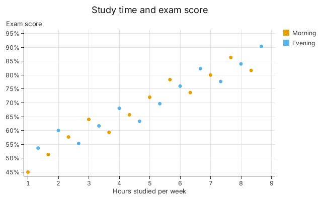
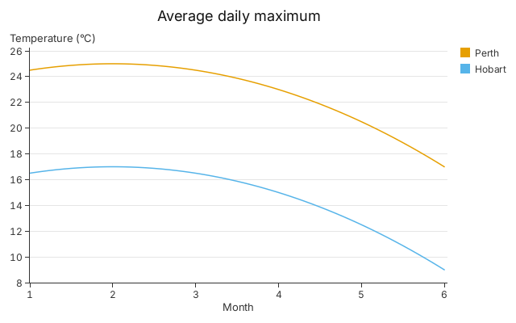
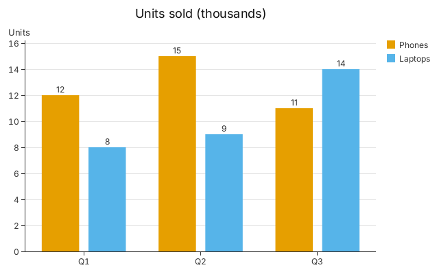
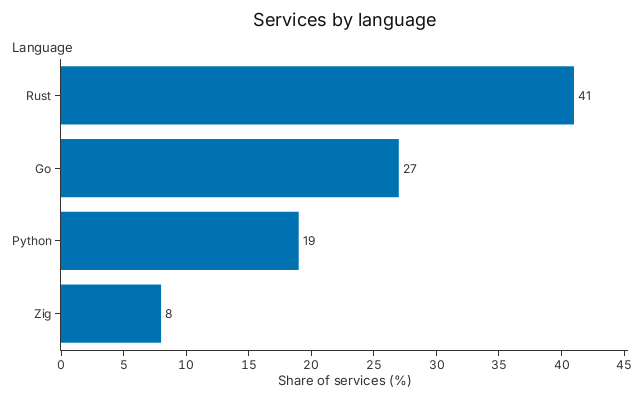
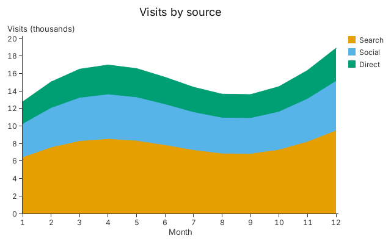
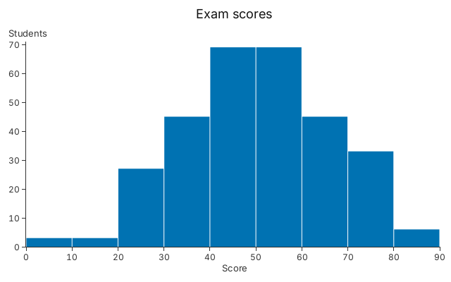
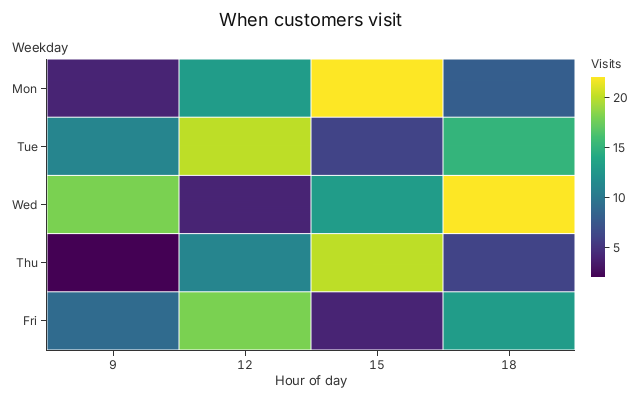
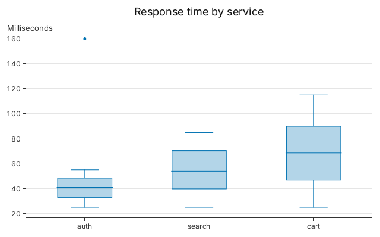
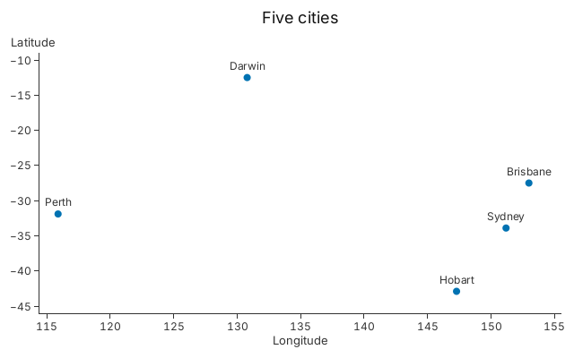
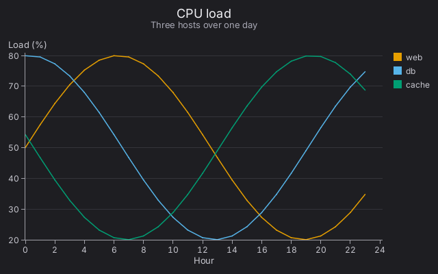

# Tutorial 7: A Tour of Chart Types

> **Goal**: find the chart that is closest to yours, copy its few lines and
> change the data.
>
> Every code block on this page is a whole program, compiled and run by
> `cargo test --doc`. Every image is a golden image checked by
> `tests/tutorials.rs`. The data is inline so that each block stands alone; in
> your program the rows come from your own `Vec`, as in
> [Tutorial 1](01_getting_started.md).

## How to Choose

Ask what you want the reader to see.

| You want to show...                      | Use                                    |
| ---------------------------------------- | -------------------------------------- |
| how two numbers relate                   | [scatter](#scatter)                    |
| how a number changes along an axis       | [line](#line)                          |
| a number for each category               | [bar](#bar) or [horizontal bar](#barh) |
| how parts add up to a whole over time    | [stacked area](#stacked-area)          |
| how many rows fall in each range         | [histogram](#histogram)                |
| a number for each pair of two categories | [heatmap](#heatmap)                    |
| how the values of each category spread   | [box plot](#box-plot)                  |
| what a particular mark is                | [annotations](#annotations)            |

The setters have the same names on every builder: `.title`, `.subtitle`,
`.x_title`, `.y_title`, `.grid`, `.x_tick_format`, `.y_tick_format` and `.theme`
work on all of them, and `.color` colours by a category on all but the heatmap.
Each block below ends by drawing the chart, so you can run it as it stands; to
keep the picture write
`chart.save_png(&Context::shared()?, "chart.png", 640, 400)?` instead.

## Scatter

Use a scatter chart to ask whether two numbers move together. Each row is a
disc; `.color` splits the rows into groups, and rows may be plain tuples.
`.y_tick_format` takes a closure that turns a tick's value into its label.

```rust
use gup::prelude::*;

fn main() -> gup::Result<()> {
    let students = (0..24).map(|i| {
        let hours = f64::from(i) / 3.0 + 1.0;
        let score = 40.0 + 5.0 * hours + f64::from(i * 7 % 11);
        (hours, score, ["Morning", "Evening"][i as usize % 2])
    });
    let mut chart = gup::scatter(students)
        .x(|s| s.0)
        .y(|s| s.1)
        .color(|s| s.2)
        .title("Study time and exam score")
        .x_title("Hours studied per week")
        .y_title("Exam score")
        .y_tick_format(|v| format!("{v:.0}%"))
        .grid(Axes::Both);
    chart.render(&Context::shared()?, 640, 400)?;
    Ok(())
}
```



Sizing the discs by a third number is in
[Tutorial 1](01_getting_started.md#step-4-colour-by-key-size-by-value).

## Line

Use a line chart when the x axis is ordered, such as time, and the reader should
follow the trend. Rows must be sorted by x; `.color` draws one line per key.
`.curve(Curve::MonotoneX)` draws a smooth curve through every row that never
overshoots a value. For a quantity that holds until it changes, such as a price
or a setting, use `.curve(Curve::StepAfter)` instead: it draws each value level
until the next row, then upright.

```rust
use gup::prelude::*;

fn main() -> gup::Result<()> {
    let rows = (1..=6).flat_map(|m| {
        let t = f64::from(m) * 2.0 - f64::from(m * m) / 2.0;
        [(m, "Perth", 23.0 + t), (m, "Hobart", 15.0 + t)]
    });
    let mut chart = gup::line(rows)
        .x(|r| f64::from(r.0))
        .y(|r| r.2)
        .color(|r| r.1)
        .curve(Curve::MonotoneX)
        .title("Average daily maximum")
        .x_title("Month")
        .y_title("Temperature (°C)")
        .grid(Axes::Y);
    chart.render(&Context::shared()?, 640, 400)?;
    Ok(())
}
```



## Bar

Use a bar chart to compare a number across a few categories. `.group` puts the
rows that share a category side by side, one bar per key; `.stack` stacks them.
`.value_labels()` writes each bar's value above it, and `.group_padding(0.2)`
sets the gap between the slots of a group as a fraction of a slot (the default
is 0.1; 0 makes the bars touch).

```rust
use gup::prelude::*;

fn main() -> gup::Result<()> {
    let sales = [
        ("Q1", "Phones", 12.0), ("Q1", "Laptops", 8.0), ("Q2", "Phones", 15.0),
        ("Q2", "Laptops", 9.0), ("Q3", "Phones", 11.0), ("Q3", "Laptops", 14.0),
    ];
    let mut chart = gup::bar(sales)
        .x(|s| s.0)
        .y(|s| s.2)
        .group(|s| s.1)
        .group_padding(0.2)
        .value_labels()
        .title("Units sold (thousands)")
        .y_title("Units")
        .grid(Axes::Y);
    chart.render(&Context::shared()?, 640, 400)?;
    Ok(())
}
```



## Barh

Use `gup::barh` when the category names are long or there are many of them: the
names read left to right instead of being squeezed under narrow bars. It is a
bar chart turned on its side, so the roles of the axes swap: `.y` is the
category and `.x` the value. The first row is at the top, so sort your rows to
make a ranking.

A category closure returns an owned key: for a `String` field write
`l.name.clone()`, as here. (`l.name.as_str()` does not compile.)

```rust
use gup::prelude::*;

struct Language {
    name: String,
    share: f64,
}

fn main() -> gup::Result<()> {
    let languages = [("Rust", 41.0), ("Go", 27.0), ("Python", 19.0), ("Zig", 8.0)]
        .map(|(name, share)| Language { name: name.to_string(), share });
    let mut chart = gup::barh(languages)
        .y(|l| l.name.clone())
        .x(|l| l.share)
        .value_labels()
        .title("Services by language")
        .x_title("Share of services (%)")
        .y_title("Language");
    chart.render(&Context::shared()?, 640, 400)?;
    Ok(())
}
```



## Stacked Area

Use a stacked area chart to show how a total is made of parts over time.
`.stack` piles one area on another, so the top edge is the total and the band
between two edges is one part. Use a line chart instead when the reader should
compare the parts to each other: it is hard to read the size of a layer that
does not sit on the baseline. `.outline(1.0)` draws a line along each layer's
top. (`.color` instead of `.stack` overlaps the areas at half opacity.) Rows are
sorted by x for you when stacked.

```rust
use gup::prelude::*;

fn main() -> gup::Result<()> {
    let visits = (1..=12).flat_map(|month| {
        [("Search", 5.0), ("Social", 3.0), ("Direct", 2.0)].map(move |(source, base)| {
            let m = f64::from(month);
            (m, source, base * (1.0 + m / 12.0 + 0.4 * (m / 2.0).sin()))
        })
    });
    let mut chart = gup::area(visits)
        .x(|v| v.0)
        .y(|v| v.2)
        .stack(|v| v.1)
        .outline(1.0)
        .title("Visits by source")
        .x_title("Month")
        .y_title("Visits (thousands)");
    chart.render(&Context::shared()?, 640, 400)?;
    Ok(())
}
```



## Histogram

Use a histogram to see the shape of one column of numbers: where the values
cluster, how far they spread and whether there are gaps. Gup counts the rows
into bins whose edges fall on round numbers. `Bins::Width(10.0)` fixes the
width; the default, `Bins::Auto`, chooses a width for you. Add `.color` to stack
each bin's count by key. Unlike a bar chart, the bars are ranges of a number, so
their order is fixed.

```rust
use gup::prelude::*;

fn main() -> gup::Result<()> {
    let scores = (0..300).map(|i| f64::from((i * 37 % 100 + i * 61 % 100 + i * 17 % 100) / 3));
    let mut chart = gup::histogram(scores)
        .x(|s| *s)
        .bins(Bins::Width(10.0))
        .title("Exam scores")
        .x_title("Score")
        .y_title("Students");
    chart.render(&Context::shared()?, 640, 400)?;
    Ok(())
}
```



## Heatmap

Use a heatmap for a number that belongs to a pair of categories, such as a count
by weekday and hour, when a table would be too many digits to read. Each row
draws one cell at its `x` and `y` category, coloured by `.color_value` through a
continuous colour scale, with a legend. There is no counting: one row, one cell,
so total your rows first. Categories run in the order they first appear.

```rust
use gup::prelude::*;

fn main() -> gup::Result<()> {
    let visits = ["Mon", "Tue", "Wed", "Thu", "Fri"].into_iter().enumerate().flat_map(
        |(d, day)| [9, 12, 15, 18].map(move |hour| (hour, day, ((d * 7 + hour * 3) % 23) as f64)),
    );
    let mut chart = gup::heatmap(visits)
        .x(|v| v.0)
        .y(|v| v.1)
        .color_value(|v| v.2)
        .legend_title("Visits")
        .title("When customers visit")
        .x_title("Hour of day")
        .y_title("Weekday");
    chart.render(&Context::shared()?, 640, 400)?;
    Ok(())
}
```



## Box Plot

Use a box plot to compare how the values of several categories are spread, when
a bar of their average would hide it. Each box runs from the first to the third
quartile and holds the median as a line; the whiskers reach the most extreme
values within 1.5 times the box's height, and each value beyond them is a dot,
like the slow `auth` request below. Gup does the statistics: give it one row per
value.

```rust
use gup::prelude::*;

fn main() -> gup::Result<()> {
    let requests = (0..90)
        .map(|i| {
            let service = ["auth", "search", "cart"][i % 3];
            (service, 25.0 + (i * 7 % 31) as f64 * (1 + i % 3) as f64)
        })
        .chain([("auth", 160.0)]);
    let mut chart = gup::boxplot(requests)
        .x(|r| r.0)
        .y(|r| r.1)
        .title("Response time by service")
        .y_title("Milliseconds")
        .grid(Axes::Y);
    chart.render(&Context::shared()?, 640, 400)?;
    Ok(())
}
```



## Annotations

Use a text layer to name the marks that matter: a handful of labels, placed at
data positions, read faster than a legend. A builder is a chart, and
`.plot_mut()` hands you its `Plot`, to which `.text(rows)` adds a layer of
labels. They go through the plot's scales like any mark. `Anchor::BOTTOM` puts
the bottom-centre of each label on its point, and `.dy(-6.0)` lifts it 6 pixels
clear of the disc.

```rust
use gup::prelude::*;

fn main() -> gup::Result<()> {
    let cities = [
        ("Perth", 115.9, -31.9),
        ("Darwin", 130.8, -12.5),
        ("Brisbane", 153.0, -27.5),
        ("Sydney", 151.2, -33.9),
        ("Hobart", 147.3, -42.9),
    ];
    let mut chart = gup::scatter(cities)
        .x(|c| c.1)
        .y(|c| c.2)
        .radius(4.0)
        .title("Five cities")
        .x_title("Longitude").y_title("Latitude");
    chart.plot_mut().text(cities).x(|c| c.1).y(|c| c.2).text(|c| c.0).anchor(Anchor::BOTTOM).dy(-6.0);
    chart.render(&Context::shared()?, 640, 400)?;
    Ok(())
}
```



Labels are laid out on the CPU, for tens to a few thousand of them; they are not
hoverable. For a title under the title, `.subtitle("...")` is on every builder.

## A Dark Theme

`.theme(Theme::dark())` restyles the whole chart for a dark background: the
background, text, axes, grid and the default palette, which is retuned to stay
distinguishable. It works on every chart above. This one also has a `.subtitle`.

```rust
use gup::prelude::*;

fn main() -> gup::Result<()> {
    let loads = [("web", 0.0), ("db", 1.5), ("cache", 3.0)].into_iter().flat_map(|(host, phase)| {
        (0..24).map(move |h| (f64::from(h), host, 50.0 + 30.0 * (f64::from(h) / 4.0 + phase).sin()))
    });
    let mut chart = gup::line(loads)
        .x(|r| r.0)
        .y(|r| r.2)
        .color(|r| r.1)
        .title("CPU load")
        .subtitle("Three hosts over one day")
        .x_title("Hour")
        .y_title("Load (%)")
        .grid(Axes::Y)
        .theme(Theme::dark());
    chart.render(&Context::shared()?, 640, 400)?;
    Ok(())
}
```



## Where Next

- [Tutorial 2: Plots and Selections](02_data_binding.md) shows what a builder is
  made of, so that you can put an area under a line, or labels over a heatmap,
  on one set of axes.
- [Tutorial 4: Interactions](04_interactions.md) adds hover, zoom and brushing
  to any of these charts.
- A chart none of these draws can be built from marks one level down:
  [Tutorial 6: Custom Marks](06_custom_marks.md).
